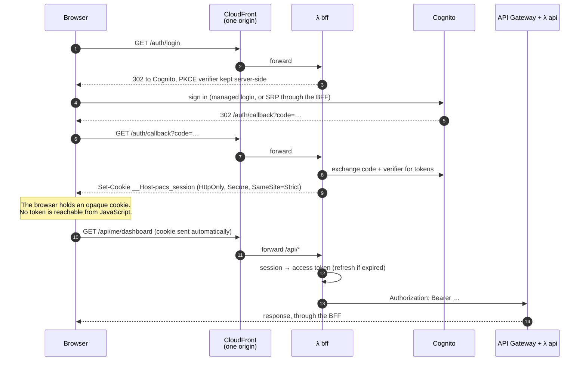
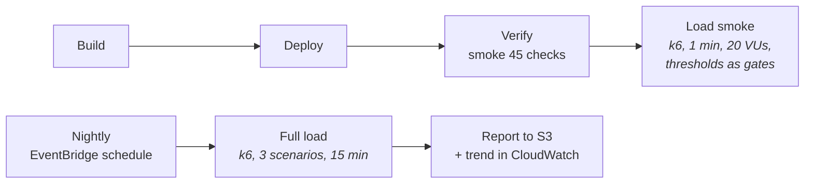

# PACS — Improvements

What this system should do next, and why. Each proposal starts from **what exists today** —
checked against the code on 2026-10-14 — then says what to build, how, what it costs, and
what it does not solve. They are proposals, not decisions: each one that is taken becomes
an ADR or a pull request, as the communication plan describes (§5).

The current system is described in the [technical documentation](delivery/01-technical-documentation.md);
its known gaps are in §13 there. This document goes further than closing gaps: it is the
list a senior engineer would bring to the first planning session after launch.

| # | Improvement | Area | Priority | Size |
|---|---|---|---|---|
| 1 | [A Backend-for-Frontend with HttpOnly cookies](#1-a-backend-for-frontend-bff-with-httponly-cookies) | Security | **High** | L |
| 2 | [Integration tests on Testcontainers](#2-integration-tests-on-testcontainers) | Quality | **High** | M |
| 3 | [Load testing in the pipeline](#3-load-testing-in-the-pipeline) | Reliability | Medium | M |
| 4 | [Accessibility to WCAG 2.2 AA](#4-accessibility-to-wcag-22-aa) | Product | **High** | M |
| 5 | [Server-side rendering and prerendering](#5-server-side-rendering-and-prerendering) | Performance | Low | M |
| 6 | [Internationalisation, finished](#6-internationalisation-finished) | Product | Medium | M |
| 7 | [Email and notifications that reach people](#7-email-and-notifications-that-reach-people) | Product | **High** | S |
| 8 | [An event pipeline that loses nothing](#8-an-event-pipeline-that-loses-nothing) | Reliability | **High** | S |
| 9 | [Security hardening at the edge](#9-security-hardening-at-the-edge) | Security | Medium | M |
| 10 | [Observability someone is paged by](#10-observability-someone-is-paged-by) | Operations | Medium | S |
| 11 | [Safer delivery: migrations, rollback, previews](#11-safer-delivery-migrations-rollback-previews) | Delivery | Medium | L |
| 12 | [Supply chain and contract checks](#12-supply-chain-and-contract-checks) | Quality | Low | S |
| 13 | [Data: a database of its own](#13-data-a-database-of-its-own) | Operations | Medium | M |

Sizes: **S** is days, **M** is about a sprint, **L** is more than one.

---

## 1. A Backend-for-Frontend (BFF) with HttpOnly cookies

### Today

The Angular app signs in with `amazon-cognito-identity-js` (`USER_SRP_AUTH`, so the password
never leaves the browser) and the library keeps the ID, access and refresh tokens in
**`localStorage`**. Every API call carries `Authorization: Bearer <access token>`. The
comment in `cognito.service.ts` defends this honestly: it is the normal arrangement for a
public SPA client, and the API authorises every request on its own.

The weakness is what happens on the day there is an XSS hole — a vulnerable dependency, a
template that renders untrusted HTML. Any script running in the page can read
`localStorage`, and the **refresh token is valid for 30 days**. One injected line exfiltrates
a credential that outlives the bug, the session and the fix.

### Proposal

Move the tokens out of the browser. A small BFF sits on the same origin as the app and is
the only component that ever holds a token:



How it fits this system:

- **One origin.** CloudFront already fronts the app; add a behaviour for `/auth/*` and
  `/api/*` pointing at the BFF. Same-origin requests mean no CORS and a cookie with
  `SameSite=Strict`.
- **The cookie.** `__Host-pacs_session`, `HttpOnly`, `Secure`, `SameSite=Strict`, `Path=/`.
  The `__Host-` prefix forbids a `Domain` attribute, so a sibling subdomain cannot plant
  or read it.
- **Session storage.** The tokens are too large for a cookie (Cognito ID tokens run past
  1 KB, and a cookie caps at 4 KB with everything else). Store them in DynamoDB — the
  `pacs-cache` table already has TTL — keyed by a random session id, and put only that id,
  signed, in the cookie. Revoking a session is deleting a row.
- **CSRF.** `SameSite=Strict` stops cross-site sends in every current browser. Add a
  second layer anyway: every state-changing request must carry a custom header
  (`X-PACS-CSRF`) that a cross-site form cannot set, checked by the BFF.
- **Refresh.** The BFF refreshes server-side and rotates; the browser never sees a refresh
  token. Sign-out deletes the session row and calls Cognito's revoke endpoint.
- **The API does not change.** It still receives a bearer token and still verifies it at the
  API Gateway authorizer. The BFF is a translator, not a new trust boundary — which keeps
  the camera account and scripts working against the API directly.
- **Network.** The BFF talks to Cognito's token endpoint, which is on the internet, so it
  runs **outside the VPC** like `integrations` — the no-NAT rule (ADR-016) still holds.

### Costs and what it does not solve

- Every API call gains a hop and a DynamoDB read. Single-digit milliseconds, but measured,
  not assumed (§3 is how).
- An XSS hole can still **use** the session while the page is open — it can call the API as
  the victim. What it can no longer do is **take the credential away** and keep using it.
  Content Security Policy (§9) is the other half of the defence.
- The SRP sign-in form either moves behind the BFF or is replaced by Cognito managed login.
  Managed login is simpler and already branded (`apply-login-branding.mjs`).

---

## 2. Integration tests on Testcontainers

### Today

267 unit tests cover the domain and the use cases with fake repositories, which is right
for the rules. What they cannot prove is the SQL: the Kysely repositories, the
`REPEATABLE READ` snapshot, the partial unique index that is the run lock, the
append-only privileges. Those are checked by `scripts/run-draw.ts`, **by hand**, against the
shared dev database, from the one machine its security group admits. CI never runs them,
and a migration is first executed against the database everybody uses.

### Proposal

Run the infrastructure ring's tests against a **real PostgreSQL 18 in a container**, started
per test run by [Testcontainers](https://node.testcontainers.org/):

```ts
// apps/api/test/integration/setup.ts — the shape, not the final code
const pg = await new PostgreSqlContainer('postgres:18.3').start();
await runMigrations(pg.getConnectionUri());          // the real migrations, up
await seedRoles(pg);                                  // app_user, pacs_app, the revokes
export const db = createKysely(pg.getConnectionUri()); // connected AS app_user
```

What it buys, specifically for this codebase:

- **Every migration runs `up` and `down` on every pull request.** The waiting-time-fairness
  migration drops a table and recreates it in `down`; today nothing proves `down` works.
- **The run lock is proven, not trusted.** Two concurrent `openRun` calls; exactly one
  succeeds and the other is a `RunLockHeldError`.
- **The audit trail is proven append-only.** Connected as `app_user`, an `UPDATE
  allocation_history` must fail with `permission denied`. If a migration ever re-grants it,
  CI goes red.
- **`run-draw.ts` becomes a test** instead of a ritual.
- DynamoDB-backed adapters (cache, cooldown, subject links) run against
  **DynamoDB Local** in a second container.

Where it runs: GitHub Actions' Ubuntu runners have Docker, so it is a seventh required
check — `Integration tests` — taking roughly a minute with the image cached. It needs no AWS
credentials, which keeps the rule that pull request checks never touch AWS.

### Costs

- A Postgres container per run: about 5–10 s to start. Share one container across the
  suite and wrap each test in a rolled-back transaction to keep it fast.
- The developer needs Docker locally to run them; the unit suite stays Docker-free so the
  three-second loop survives.

---

## 3. Load testing in the pipeline

### Today

There is no load test. Two facts make that riskier than it sounds:

- The account's **Lambda concurrency quota is 10**. A burst of residents opening the
  dashboard when results are published will be throttled with `429`s long before
  anything is slow.
- The database is a **`db.t4g.micro`**, at most 10 containers × 2 connections = 20.

Nobody knows today how many simultaneous residents this serves.

### Proposal

[k6](https://k6.io) scripts in `apps/api/load/`, in three scenarios modelled on how the
building actually behaves:

| Scenario | Shape | Pass criteria |
|---|---|---|
| **Results day** | 0 → 200 virtual users in 2 min, all reading `GET /me/dashboard` and `GET /lots/{level}/occupancy` | p95 < 800 ms, error rate < 1 %, cache hit ratio visible |
| **Registration rush** | 50 users entering and withdrawing (`POST`/`DELETE /cycles/{id}/registrations`) | No 5xx; idempotency holds — no duplicate registrations |
| **Gate morning** | 2 captures per second for 10 min (`POST /captures` + S3 PUT) | Iterator age of `plateIngest` stays under 60 s |

Two tiers, so the pipeline stays fast:



- **Load smoke** after Verify, on every release: one minute, small, with k6 `thresholds`
  that fail the stage. It catches the regression that turns a 100 ms route into a 2 s one.
- **Full load** nightly, never on the release path, writing its summary to S3 and its key
  numbers to CloudWatch as custom metrics, so a trend is visible.

The first full run is a measurement, not a test: its job is to find out where the 10-way
concurrency limit bites, and that number goes into the technical documentation and into
the conversation about a quota increase.

### Costs and cautions

- Load against `dev` disturbs whoever is demonstrating on it — the nightly run is at night
  for that reason, and is announced like any other destructive operation.
- Rekognition is charged per image; the gate scenario uses a small fixed set of frames and
  is the one to run least often.

---

## 4. Accessibility to WCAG 2.2 AA

### Today

The app is in better shape than most: Angular Material components carry ARIA roles, the
navigation drawer closes on Escape and keeps a closed menu out of the tab order, animations respect
`prefers-reduced-motion`, and there are about 140 explicit ARIA attributes across the
features. But nothing **verifies** any of it, and some screens are hard by nature: the lot
plan is an SVG map, the gate page is a camera feed, and the draw result appears
asynchronously.

A resident who uses a screen reader, cannot use a mouse, or has low vision has the same
claim to a parking bay as anyone else. In a residential building that is not a niche.

### Proposal

Target **WCAG 2.2 level AA**, and make it a check, not a hope.

**Automated, in CI**

- [`@axe-core/playwright`](https://github.com/dequelabs/axe-core-npm) in the existing end-to-end
  suite: every screen, in both themes, at 390 px and 1280 px, fails the build on any
  `serious` or `critical` violation.
- Lint templates with `@angular-eslint/template` accessibility rules
  (`alt-text`, `label-has-associated-control`, `interactive-supports-focus`, …).

**By design, screen by screen**

| Where | What to do |
|---|---|
| **The lot plan** | An SVG map is invisible to a screen reader. Give it `role="img"` with a summary ("Level B1: 8 bays, 5 held, yours is B1-04") and a **"view as table"** toggle listing every bay, its status and holder. The table is the accessible version; the map is the visual one |
| **Run the draw / results** | Announce completion through Angular CDK's `LiveAnnouncer` ("Draw complete: 8 bays assigned, 4 on the waitlist") so a screen-reader user is not left on a silent page |
| **Status pills** | Status is never colour alone: every pill already has text — keep it that way, and check contrast of both themes against 4.5:1 |
| **Route changes** | Move focus to the page's `<h1>` after navigation and update `document.title`, so a screen reader announces where you are |
| **Forms** | Errors linked with `aria-describedby`, announced on submit, and the first invalid field focused |
| **Dialogs** | Release and withdraw dialogs state a cost; make sure that text is in the dialog's accessible description, not only visible |
| **Target size** | WCAG 2.2's 24 × 24 px minimum for every control, including the table row actions on a phone |
| **The gate camera** | Inherently visual; provide a manual plate entry so an operator who cannot use the camera feed can still record an arrival |

**By people**

- A manual pass with **NVDA + Firefox**, **VoiceOver + Safari** and **keyboard only**
  before each release that changes a screen, using a short written script per screen.
- An accessibility statement page: what is supported, what is known not to be, and how to
  report a barrier.

### Costs

Mostly engineering time, front-loaded. The axe check will fail on day one; the first
sprint is fixing what it finds, after which it protects the result.

---

## 5. Server-side rendering and prerendering

### Today

A pure client-side SPA: CloudFront serves `index.html` and the bundles, and the browser
renders everything. Every route is lazy, so a resident never downloads admin code.

### Proposal — and an honest recommendation

Angular supports SSR with hydration (`@angular/ssr`) and build-time prerendering. They are
worth different amounts here:

| Option | What it gives | Worth it here? |
|---|---|---|
| **Prerender public routes** (`/login`, `/welcome`, the accessibility statement) | Instant first paint and real HTML for the only pages an anonymous visitor sees. Static files in S3, no new runtime | **Yes** — cheap, no infrastructure |
| **Full SSR** on a Lambda behind CloudFront | First paint with data for signed-in screens; incremental hydration | **Only with §1.** Today's tokens live in `localStorage`, which the server cannot see, so SSR could only render empty shells. With the BFF's cookie the server *can* render the dashboard with the resident's data |
| **SEO** | — | Not a goal: the product is behind a sign-in |

So: **prerender now; revisit full SSR after the BFF exists**, and only if measurement says
first paint on a phone is the problem worth solving. When it is done:

- SSR runs on a Lambda outside the VPC (it calls the API, not the database).
- Code that touches `window`, `localStorage` or `navigator.mediaDevices` (the gate) must be
  guarded with `isPlatformBrowser` or `afterNextRender` — the gate page stays client-only.
- `withHttpTransferCache` so data fetched on the server is not fetched again on hydration.

---

## 6. Internationalisation, finished

### Today

Transloco is installed but not wired; the UI is English only. The specification requires
Spanish and English. One sentence resists translation: the fairness explanation comes back
from the API as finished English prose.

### Proposal

- Wire Transloco with `en` and `es`, the language chosen from the browser and remembered
  per user.
- **Change the explanation contract** to a message key plus parameters
  (`{ key: "explanation.waitlisted", params: { position: 3, waitHours: 412 } }`) and
  render the sentence in the client. The plates module already does exactly this with
  `access_event.reason` — follow it.
- Dates, numbers and plate formats through Angular's locale pipes.
- Set `<html lang>` per language: it is also an accessibility requirement (§4) — a screen
  reader pronounces Spanish with an English voice otherwise.

---

## 7. Email and notifications that reach people

### Today

Since pull request #24 the user pool sends through SES. SES is still in **sandbox**: it
delivers only to verified addresses, 200 a day. The sender is a personal Gmail address,
because the corporate domain's DMARC policy (`p=reject`) forbids SES sending in its name.
The allocation events (`SpotAssigned`, `ResidentWaitlisted`, …) reach `integrations` and are
logged, not sent.

### Proposal

1. **Request SES production access.** Without it, a new resident's invitation fails unless
   their address was verified by hand.
2. **A domain the building controls**, verified in SES with **DKIM and SPF**, and a DMARC
   policy that allows SES. Mail then comes from `no-reply@<building domain>` and stops
   landing in spam.
3. **The notification templates** (SES templates, in both languages): "you have a bay",
   "you are number N on the waitlist", "a bay was released and it is yours".
4. **Bounce and complaint handling** through an SES configuration set → SNS → a flag on the
   resident, so the administrator sees "email bouncing" instead of a silent failure.

---

## 8. An event pipeline that loses nothing

### Today

`integrations` consumes the DynamoDB stream, retries a failed record three times, and then
**drops it**. On 2026-10-14 that is how a resident ended up with no Cognito user and no
trace of why except in CloudTrail. Its error log also writes under the key `message`, which
the logger discards.

### Proposal

- An **SQS on-failure destination** on the stream mapping. A failed record lands in a
  queue with its full payload, an alarm fires when the queue is non-empty, and a small
  script redrives it after the cause is fixed.
- Log the error as `detail` with the AWS error `name` (the same fix pull request #20 made in
  the API).
- An **administrator-visible provisioning state** on the resident ("account pending",
  "invitation failed — retry"), so the person who created the resident sees the failure
  instead of the resident reporting it.

---

## 9. Security hardening at the edge

### Today

CloudFront sends HSTS, `nosniff`, `X-Frame-Options: DENY` and a referrer policy. There is
no Content Security Policy, no WAF, no per-route rate limit, MFA is optional for
administrators, and the database TLS is encrypted but not verified.

### Proposal

| Measure | Why |
|---|---|
| **Content Security Policy** in the CloudFront response headers policy: `default-src 'self'`, `connect-src` the API and Cognito, `frame-ancestors 'none'`, no `unsafe-inline` scripts | The first defence against XSS; with §1 it makes stolen sessions much harder |
| **AWS WAF** on CloudFront with the managed common rule set and a rate-based rule | Credential stuffing against sign-in, and abusive clients, stopped before they cost Lambda invocations |
| **Per-route throttling** on API Gateway (`POST /captures`, `POST /cycles/{id}/runs`) | A misbehaving camera should not exhaust the 10-way concurrency for everyone |
| **Mandatory TOTP MFA for the `ADMIN` group** | An administrator account runs the draw and can remove residents |
| **`verify-full` TLS to RDS** with the RDS CA bundle shipped in the Lambda | Encrypted is not the same as authenticated |
| **Close the database to the internet** once migrations run from inside the VPC (§11) | Today the security group admitting one `/32` is the whole protection |

---

## 10. Observability someone is paged by

### Today

Two CloudWatch alarms exist and fire into the console; nobody is notified. Logs are
structured and carry a trace id, which is a good base.

### Proposal

- Route alarms to **SNS → email/Slack**, and add the ones that matter: API 5xx rate, Lambda
  throttles (the concurrency limit, §3), `integrations` failures (§8), SES bounce rate, run
  stuck `RUNNING`.
- One **CloudWatch dashboard** per environment: requests, p95 latency, errors, throttles,
  cache hit ratio, plate pipeline lag.
- **CloudWatch RUM** in the Angular app: real users' load times and JavaScript errors,
  carrying the same trace id the API logs, so a resident's "it broke" becomes one query.

---

## 11. Safer delivery: migrations, rollback, previews

### Today

Migrations are applied by hand before the deploy that needs them, because CodeBuild cannot
reach the database. A bad backend deploy is undone by redeploying the previous commit.
There is one environment.

### Proposal

- **A `migrate` Lambda inside the VPC**, invoked by the Deploy stage before
  `serverless deploy`. The pipeline then owns the order, and the database can be closed to
  the internet (§9).
- **Gradual Lambda deployments**: publish versions behind an alias and shift traffic with
  CodeDeploy (`Linear10PercentEvery1Minute`), rolling back automatically if the API 5xx
  alarm fires.
- **A staging stage** promoted from dev by the same pipeline, with a manual approval
  action, before anything carries a real building.
- **Preview environments** for pull requests that change the frontend: the built bundle
  synced to `s3://…/pr-<n>/` behind the same distribution, pointing at dev's API.

---

## 12. Supply chain and contract checks

- **Renovate or Dependabot** for weekly dependency updates, grouped, through the same six
  checks. Today nothing proposes raising the lockfile.
- **CodeQL** on pull requests for the TypeScript in both apps.
- **Contract tests**: validate every API response in the smoke suite against
  `packages/contracts/openapi.yaml` (with an OpenAPI validator), so the stub, the real API
  and the contract cannot drift apart silently.
- **SBOM** generated at build and stored with the artefact.

---

## 13. Data: a database of its own

### Today

`pacs_dev` lives on a shared instance (`hotel-db`, `db.t4g.micro`, single-AZ, backups kept
**one day**). The specification asks for a dedicated instance and seven-day backups.

### Proposal

- A **dedicated RDS instance** (or Aurora Serverless v2 if load testing shows bursty demand),
  Multi-AZ when it carries a real building.
- **Backups 7 days, point-in-time recovery**, and a **restore drill** each quarter — a
  backup never restored is a hope.
- **RDS Proxy** if §3 shows connection pressure: it pools connections across Lambda
  containers and keeps IAM authentication.

---

## Suggested order

```mermaid
flowchart LR
  subgraph now["Next sprint"]
    A7["7 · SES production access"]
    A8["8 · DLQ + logger fix"]
    A2["2 · Testcontainers"]
  end
  subgraph soon["Following two sprints"]
    B4["4 · Accessibility"]
    B1["1 · BFF + cookies"]
    B9["9 · CSP + WAF + admin MFA"]
  end
  subgraph later["After that"]
    C3["3 · Load testing"]
    C11["11 · migrate Lambda, gradual deploys"]
    C6["6 · i18n"]
    C10["10 · alarms, RUM"]
    C5["5 · prerender, then SSR"]
    C13["13 · dedicated database"]
    C12["12 · supply chain"]
  end
  now --> soon --> later
```



The reasoning: **7 and 8** fix failures residents have already hit. **2** makes every later
change to the data layer safe. **4** is a right, not a feature, and gets more expensive the
more screens are built without it. **1** and **9** are the security pair — the BFF removes the
stolen-token risk and CSP removes most of the way it would happen. Load testing comes once
the shape of the system has settled, so its numbers stay true.
