# PACS — Technical documentation

Parking Allocation Context System. This document is written for the next engineer on the
project: what the system is, how it is put together, how to run it, how to deploy it, what
the data and the rules are, and where the edges are.

Everything here was checked against the code in this repository and, where it concerns
deployed infrastructure, against the `dev` account itself. Where the code and the older
specification disagree, the code wins and the disagreement is stated.

| | |
|---|---|
| Repository | `jcallisayaunosquare/pacs-parking-allocation`, default working branch `development` |
| Account · region | `309887812390` · `us-east-2` — the only region the organisation's SCP permits |
| API | `https://frd8e8nkhl.execute-api.us-east-2.amazonaws.com` |
| Site | `https://d2gamvhpvfk16e.cloudfront.net` |
| Identity | Cognito user pool `pacs-dev` (`us-east-2_NsdZ4M0mj`), app client `2tu4q5vefr1g98u90u8dspmife` |
| Database | RDS PostgreSQL 18.3, instance `hotel-db`, database `pacs_dev` |
| Stacks | `pacs-api-dev` (Serverless Framework v4) · `pacs-web-hosting-dev` · `pacs-pipeline-dev` (CloudFormation) |

---

## 1. What the system is

A residential building has fewer parking bays than residents. PACS allocates them on a
recurring period — three months by default, but the duration is a configuration value, not
a constant — by a stated rule rather than by discretion or by who asked first.

The shape of the work:

1. An administrator maintains the register of residents and the inventory of bays.
2. A period is created and registration is opened. Residents enter.
3. Registration closes. The administrator runs the draw.
4. Every entrant is ranked by one deterministic ordering; the top *n* get the *n* bays and
   the rest take numbered waitlist places.
5. The period runs. A resident may give up a bay, which promotes the head of the waitlist.
6. The period ends — on its own date, or because an administrator closed it early — and
   everybody's waiting time starts again from the instant their bay ended.

Alongside that sits the gate: a camera photographs a plate, the system reads it, matches it
against the register of residents' vehicles, and records allow, deny, or "a human should
look at this".

Two properties make the product what it is, and most of the design follows from them:

- **The result is explainable and re-derivable.** A run stores the configuration version it
  used, every candidate's computed key, the random seed and a hash of both its inputs and
  its output. A resident who disputes the outcome is shown the arithmetic, not a policy.
- **The record is append-only.** `allocation_history`, `allocation_run_candidate`,
  `allocation_config`, `plate_config` and `access_event` cannot be updated or deleted by
  the application's database role. This is a database privilege, not a convention, so a
  compromised application credential still cannot rewrite why somebody lost.

---

## 2. Repository layout

A pnpm workspace (`pnpm-workspace.yaml` takes `apps/*` and `packages/*`), pinned to
`pnpm@9.15.9` through `packageManager` in the root `package.json`.

```
code/
├── apps/api/                 backend — TypeScript, Lambda, Serverless Framework v4
│   ├── serverless.yml        functions, events, Cognito, DynamoDB, S3, VPC endpoint, alarms
│   ├── migrations/           node-pg-migrate, raw SQL, up and down
│   ├── scripts/              seed, offline stub API, smoke suites, operational scripts
│   └── src/
│       ├── shared/           kernel: Result, errors, Clock, db, cache, events, http
│       ├── modules/          one Clean Architecture ring set per module
│       │   ├── allocation/   M-1  periods, runs, the draw, the waitlist
│       │   ├── residents/    M-2  the register, the vehicle register
│       │   ├── inventory/    M-3  bays
│       │   ├── fairness/     M-4  standings, explanations, metrics
│       │   ├── identity/     M-6  JWT claims → Principal, RBAC
│       │   └── plates/       M-7  recognition, the gate log, access events
│       └── main/             composition roots and Lambda handlers — the only `new`
├── apps/web/                 frontend — Angular 22, standalone, zoneless, signals
├── packages/contracts/       OpenAPI 3.1 — the contract both sides are checked against
├── pipeline/dev/             CloudFormation: CodePipeline, CodeBuild, S3 + CloudFront
├── .github/workflows/ci.yml  the six pull request checks
├── .githooks/pre-commit      the local gate
└── docs/                     analisis.html (the original specification) and this set
```

Inside every backend module the same three rings, with source dependencies pointing inward
only:

- `domain/` — pure TypeScript. No `async`, no I/O, no clock, no random number generator.
  The instant and the seed are arguments. This is why the draw can be run ten thousand
  times in a unit test and the whole plate decision table verified in milliseconds.
- `application/` — use cases. Knows ports (interfaces), never an implementation.
- `infrastructure/` — Kysely, DynamoDB, S3, Rekognition, Cognito.

`src/main/` wires them. It is the only place that calls a constructor on an adapter, which
is what makes a fake repository a one-line substitution.

---

## 3. Architecture

### 3.1 The whole system at a glance

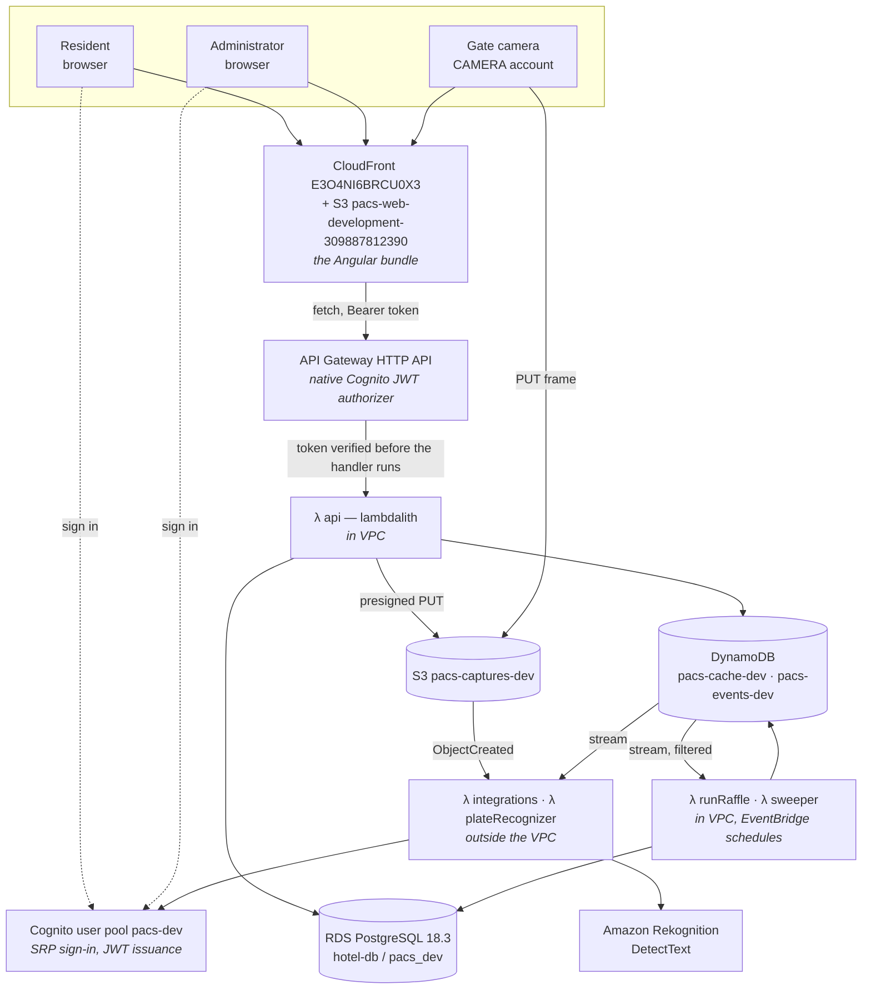

Two things in that picture are unusual and both come from one decision: **there is no NAT
gateway** (ADR-016, roughly 32 USD/month avoided). A Lambda attached to the VPC can reach
exactly two things — RDS, and DynamoDB through a free gateway endpoint. It cannot reach
Cognito, S3 or Rekognition.

So anything that needs the internet runs *outside* the VPC and is fed by a DynamoDB stream.
A stream is polled by the Lambda service, not by the function, so a function with no
outbound route can still be invoked by one. That single trick is what makes the whole
topology work, and it appears twice: once for Cognito provisioning (`integrations`) and
once, inverted, for plate recognition (`plateRecognizer` outside, `plateIngest` inside).

### 3.2 Back-end architecture — where each service intervenes

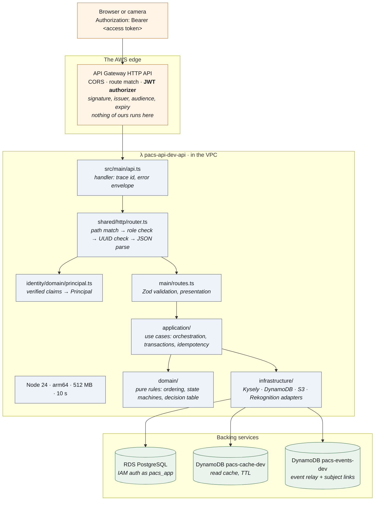

Reading that from the top, with what each layer is responsible for and what it is
deliberately *not*:

| Stage | What it does | What it must never do |
|---|---|---|
| API Gateway | Verifies the JWT's signature, issuer, audience and expiry against the Cognito pool before any code of ours runs. Answers CORS preflight itself — `OPTIONS` is left unrouted on purpose, because an `ANY` route would send the preflight to the authorizer, which would 401 it for having no `Authorization` header. | Authorise. It knows nothing about roles. |
| `api.ts` | One handler for every route (a lambdalith, ADR-014). Mints the trace id that appears in every log line and in every error body. | Hold business logic. |
| `router.ts` | Matches the path, checks the caller holds one of the route's roles, rejects any `{…id}` parameter that is not a UUID *before* it reaches a query, parses the body. | Decide which resident the caller is. It only knows the token. |
| `principal.ts` | Maps verified claims to a `Principal`: subject, email, roles from `cognito:groups`, `custom:resident_id` when present. | Read an identity from a path, query or body. |
| `routes.ts` | Zod schemas at the edge, presentation on the way out. Two guards live here because a route's `roles` list cannot express them: `adminHasNoResidentSurface` (a role list is an OR, so a principal in both groups would satisfy `['RESIDENT']`) and `residentScope` (a record-level rule the role list knows nothing about). | Reach a repository directly for a decision. |
| `application/` | Idempotency, the run lock, transactions, cache invalidation, event publication. | Contain the fairness policy. |
| `domain/` | The ordering, the state machines, the removal rules, the plate decision table. Pure. | Know that Postgres exists. |
| `infrastructure/` | SQL through Kysely, DynamoDB through the document client, presigned S3 URLs, Rekognition calls. | Make a decision. The snapshot query emits *facts* — anchors, counts, flags — and never a priority key, because duplicating the key formula in SQL and TypeScript would guarantee drift. |

The other five functions in the same stack:

| Function | Trigger | In VPC | Memory · timeout | What it is for |
|---|---|---|---|---|
| `api` | HTTP API | yes | 512 MB · 10 s | Every route |
| `runRaffle` | EventBridge `cron(0 6 * * ? *)`, plus a pre-warm at 05:55 | yes | 512 MB · 60 s | Draws for whichever period is in `REGISTRATION_CLOSED`; returns `NO_RUNNABLE_CYCLE` otherwise. A daily poll rather than a quarterly cron, because the period length is configurable and a quarterly cron would hard-code "every three months" into infrastructure no administrator can edit. |
| `sweeper` | EventBridge `rate(5 minutes)` | yes | 512 MB · 60 s | Fails runs stuck `RUNNING` for 15 minutes, expires assignments whose period has ended and closes those periods, relays the event outbox |
| `integrations` | `pacs-events-dev` stream | **no** | 512 MB · 30 s | Cognito provisioning: `AdminCreateUser`, add to `RESIDENT`, write the `link#<sub>` item back |
| `plateRecognizer` | S3 `ObjectCreated:Put` on `raw/*.jpg` and `raw/*.png` | **no** | 1024 MB · 30 s | Rekognition `DetectText` → a `PlateRecognized` event |
| `plateIngest` | `pacs-events-dev` stream, filtered to `pk` prefix `plateread#` | yes | 512 MB · 30 s | Applies the event to Postgres: `plate_read` + usually `access_event` |

Three details in that table carry weight:

- **`plateRecognizer` has 1024 MB and not 512.** A full vCPU is allocated at 1769 MB and
  the share below that is proportional. The inference is Rekognition's, but this function
  still pays for JSON, signing and the SDK on a cold start, and 1024 is where the duration
  stops falling. Measure with Lambda Power Tuning before changing it.
- **`plateIngest` must keep its `filterPatterns`.** Without them it wakes for every Cognito
  provisioning and allocation event on the shared table and pays for an RDS connection to
  discard each one.
- **No function has `reservedConcurrency`.** The account's Lambda quota is 10 concurrent
  executions and AWS requires 10 to stay unreserved, so nothing can be reserved at all. The
  quota itself bounds the connection pool: at most 10 containers × 2 connections = 20,
  inside a `t4g.micro`'s budget.

### 3.3 Front-end architecture — where each service intervenes

Angular 22, standalone components, **zoneless** (no `zone.js`), signals throughout, Angular
Material 22 with the project's own theme. The rings mirror the backend's.

<!-- figure:wide -->
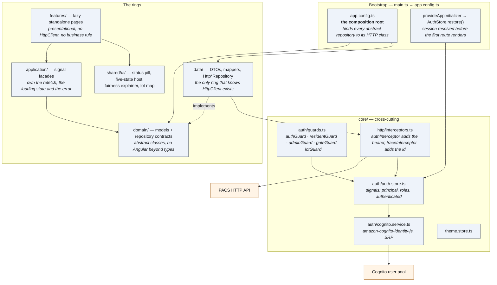

What each part is for, and the rule it enforces:

- **`app.config.ts` is the only binding site.** `{ provide: ResidentRepository, useClass:
  HttpResidentRepository }` and eleven more like it. Swap a line and the whole application
  runs against fakes — which is exactly what the unit tests do. `LotRepository` is bound to
  `SeedLotRepository` today because there is no layout endpoint yet; the day
  `GET /lots/{id}/layout` lands, one line changes and nothing above the data ring notices.
- **`domain/` holds repository *contracts as abstract classes*.** Abstract classes rather
  than interfaces because Angular's injector needs a runtime token, and an interface has
  none.
- **Facades own asynchrony, pages do not.** A page reads signals and renders. The facade
  decides when to refetch and holds the five states the `view-state` host renders (idle,
  loading, empty, error, loaded) — which is why no page in this codebase contains a
  `subscribe`.
- **Guards are usability, never security.** They stop a resident landing on a page that
  would only 403. The server is the boundary, always; the API repeats every one of these
  rules and is the one that counts.
- **Routes are lazy, one bundle per screen**, so a resident never downloads the admin
  screens.

The navigation is built from the roles on the principal, in the order the work is done —
because the order is not obvious and the menu is the only place it is written down. For an
administrator: **Residents · Bays · Fairness & rules · Periods · Run the draw · The lot ·
Gate · Reports.** "Fairness & rules" sits before "Periods" because it holds the rules
editor, and the allocation duration there decides how long the period about to be created
will run. For a resident: **My parking · The lot · History.** A `CAMERA` account gets one
link, `Gate`, and nothing else: it is a device, and the only route the server will serve it
is `POST /captures`.

Sign-in does not use the Cognito hosted page. `CognitoService` drives
`amazon-cognito-identity-js` with `USER_SRP_AUTH` from the product's own form, so the
password is never transmitted and the wrong-password, first-sign-in and MFA states are the
product's screens rather than someone else's. See §8.1.

---

## 4. AWS services

Two views of the same account. This one is the map: every service PACS uses, with its own
mark, and the path a request takes across them. The one after it is the same estate
annotated — resource names, sizes and the settings that matter — because a logo cannot
tell you that the bucket is private or that two of the functions sit outside the VPC.

<!-- figure:page -->
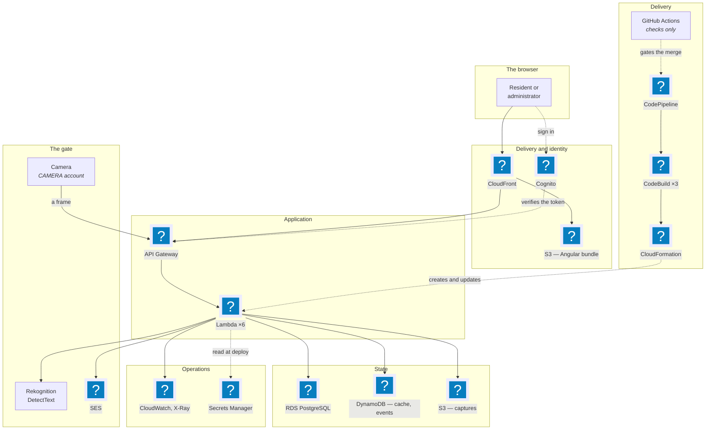

Rekognition and the camera carry no mark: the `logos` icon set has no Rekognition glyph, and
the camera is a device rather than a service. Everything else is the vendor's own.

<!-- figure:page -->
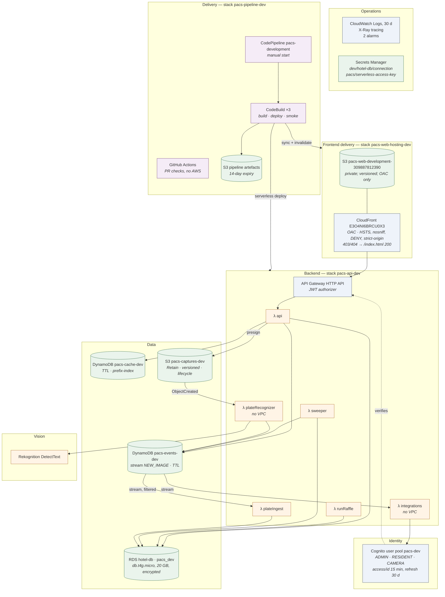

Service by service, with the boundary each one sits on:

| Service | Resource | What it does here | Boundary |
|---|---|---|---|
| CloudFront | `E3O4NI6BRCU0X3` | Serves the Angular bundle over TLS; rewrites 403 and 404 to `/index.html` with a 200 so deep links and refreshes work in a client-routed app; adds HSTS, `X-Content-Type-Options`, `X-Frame-Options: DENY` and a referrer policy | Public internet → the only public door to the frontend |
| S3 | `pacs-web-development-309887812390` | Holds the built bundle. Private, versioned, reachable only through the distribution by origin access control, scoped by `AWS:SourceArn` to that one distribution | Private; no public read, no website mode |
| Cognito | `us-east-2_NsdZ4M0mj` | Issues and signs the tokens. Groups `ADMIN`, `RESIDENT`, `CAMERA`. 12-character password policy, optional TOTP MFA, `PreventUserExistenceErrors` on | The identity boundary. Everything downstream trusts its signature and nothing else |
| API Gateway | HTTP API | Route matching, CORS, and the native JWT authorizer that rejects an invalid token before a Lambda is invoked | Public internet → the only public door to the backend |
| Lambda | six functions | All application code | The VPC boundary runs through the middle of this row — see §5 |
| RDS | `hotel-db` / `pacs_dev` | The record. PostgreSQL 18.3 on `db.t4g.micro`, 20 GB gp3, encrypted, single-AZ, IAM database authentication enabled | Inside the VPC, but the instance is **publicly accessible** — see §5 |
| DynamoDB | `pacs-cache-dev` | Read cache with TTL: the resident dashboard for 5 minutes, the fairness and plate metrics for 10. A GSI on `prefix` makes prefix invalidation one query | Reached from in-VPC functions through a free gateway endpoint |
| DynamoDB | `pacs-events-dev` | The relay between inside and outside the VPC. Carries outbox events, the `link#<sub>` subject mappings `integrations` writes back, and the `plateread#<captureId>` recognition events. `NEW_IMAGE` stream, TTL on `expiresAt` | Same gateway endpoint; the stream is polled by the Lambda service, not by our functions |
| S3 | `pacs-captures-dev` | Gate frames under `raw/<cameraId>/<yyyy>/<mm>/<dd>/<captureId>.jpg`. `DeletionPolicy: Retain`, versioned, SSE-S3, all public access blocked. Lifecycle: `raw/` to Glacier IR at 90 days and deleted at 400; `crops/` deleted at 120 | Written by a presigned PUT the camera executes; read only by `plateRecognizer` |
| Rekognition | `DetectText` | Reads text out of a frame. Behind the `PlateRecognizer` port, so replacing it is one class in `infrastructure/` and one line in `src/main` | The one IAM statement that cannot be resource-scoped — Rekognition operations that work without a collection have no ARNs — so it is scoped by action and said out loud in `serverless.yml` |
| Secrets Manager | `dev/hotel-db/connection`, `pacs/serverless-access-key` | The master connection details for migrations from a laptop, and the Serverless Framework licence key the deploy stage reads | Never reached by a deployed function: the functions use IAM database authentication and hold no secret at all |
| CloudWatch | logs, X-Ray, 2 alarms | 30-day log retention, tracing on every function. Alarms: `plateRecognizer` errors ≥ 3 in 5 minutes, and `plateIngest` iterator age > 60 s for two periods — a minute behind on that stream means the access log is behind the cars that have already driven in | — |

**IAM database authentication is the piece worth understanding.** The deployed functions
hold no database password. `connection.ts` gives `pg` an async `password` function that
mints a token with `@aws-sdk/rds-signer` per connection; the SDK signs locally, so there is
no network call and it works from inside a VPC with no internet route. The token is valid
15 minutes. The role it signs for is `pacs_app`, granted `rds_iam` and `app_user` and
nothing else. There is no database credential in the function configuration, in SSM, or in
git.

---

## 5. Network

<!-- figure:wide -->
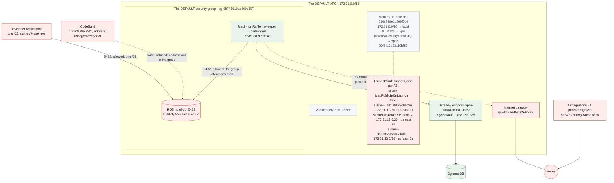

The facts, and what each one costs:

- **It is the account's default VPC.** Three default subnets, one per availability zone,
  the main route table, and the default security group. Nothing bespoke was created. The
  original specification describes dedicated private subnets with a Lambda-only security
  group; that is not what exists.
- **The subnets carry a `0.0.0.0/0` route to an internet gateway**, which by the usual
  definition makes them public subnets. The in-VPC Lambdas still have no outbound internet,
  and the reason is worth being precise about: a Lambda ENI is never assigned a public IP,
  and an internet gateway only forwards traffic for addresses that have one. So the subnets
  are public and the functions in them are effectively isolated — which is why
  `integrations` and `plateRecognizer` have to sit outside the VPC, and why DynamoDB is
  reached through a gateway endpoint rather than over the internet.
  *(The comment at the top of `pipeline/dev/buildspec-deploy.yml` says "RDS sits in private
  subnets". It does not; the conclusion it draws — that CodeBuild cannot reach the database
  — is right, but the reason is the security group, not the subnet.)*
- **`sg-0b745610ae460e557` is the default security group**, and it holds both the Lambdas
  and the database. Inbound: TCP 5432 from a single `/32` (a developer workstation, named
  in the rule's description), plus all protocols from the group itself. Outbound: all. The
  Lambdas reach the database through that self-reference, which is why they need no CIDR
  rule of their own.
- **`hotel-db` is publicly accessible.** This was asked for, so migrations and scripts can
  run from a laptop without a bastion. The security group is the whole of the protection,
  and it admits one address. Closing it again is two commands, both in the API README.
- **CodeBuild cannot reach the database at all**, and that is a consequence rather than an
  oversight: it runs outside the VPC and its source address changes every run, so no `/32`
  rule can cover it. Two things follow. Database migrations are not in the deploy stage —
  they are applied by hand from an admitted machine before the deploy that needs them, and
  that is a known gap, not a decision. And the smoke suites cannot clean up their own
  database rows; the draw in `scripts/smoke.mjs` is gated behind `DATABASE_URL` for exactly
  this reason, so the pipeline runs everything except the draw.

---

## 6. The data model

### 6.1 Conceptual

What the business is about, before any decision about how it is stored:

<!-- figure:wide -->
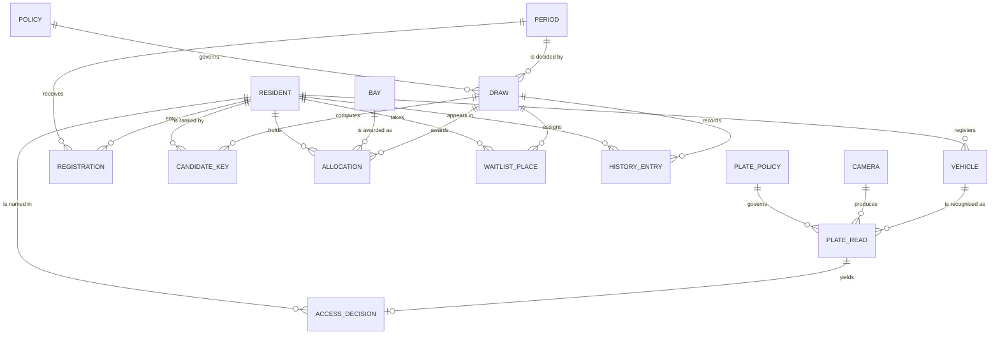

Entities only: the attributes are in §6.2 to §6.4, where they are the columns that
actually exist rather than a second, slightly different list.

Four things in that picture are deliberate and are the reason the physical schema looks the
way it does:

1. **A resident's waiting time is not an attribute of the resident.** It is derived at read
   time from two timestamps: when they started participating, and when their last bay
   stopped being a benefit. There is no counter to drift and no nightly job to fail.
2. **`CANDIDATE_KEY` exists as a thing in its own right.** Every entrant in every run gets
   a stored row with the key that ranked them. "Why did I lose?" is answered from the
   record of that run, not recomputed against data that has since moved.
3. **`POLICY` governs a draw, it does not configure the system.** A run points at the
   policy version in force when it ran, so changing the bias tomorrow cannot rewrite why
   somebody lost today.
4. **A plate read and an access decision are separate.** A mis-read can be corrected
   without rewriting the access log; a decision is overturned by inserting a new row that
   the old one points at, never by editing one.

### 6.2 Physical — what a period is made of

From `apps/api/migrations/`, as the database actually stands after all five migrations.
Split in two because a draw has an input side and an output side, and they are read at
different times: this is what exists before a draw runs.

<!-- figure:wide -->
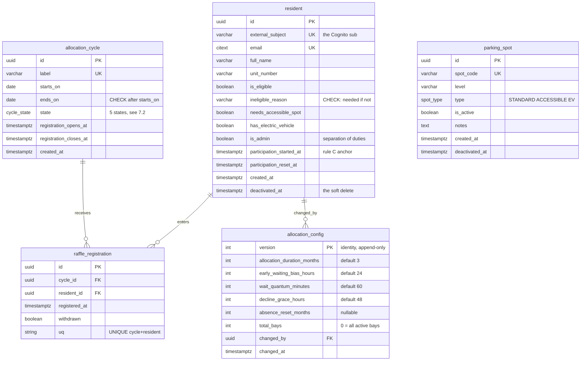

### 6.3 Physical — a run and what it produced

The output side. Every table here is written in the one transaction that commits a run,
and four of the five are append-only to the application role.

<!-- figure:wide -->
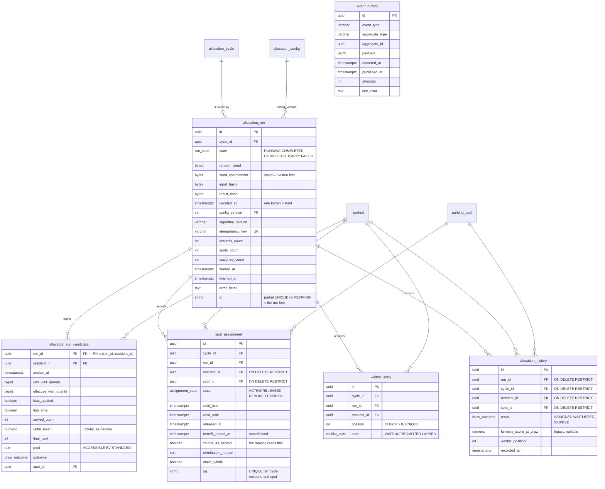

`event_outbox` has no foreign key to anything, deliberately: it is a relay, written in the
same transaction as the state change it announces and emptied by the sweeper. Nothing may
depend on a row that is about to be deleted.

### 6.4 Physical — the vehicle register and the gate

<!-- figure:page -->
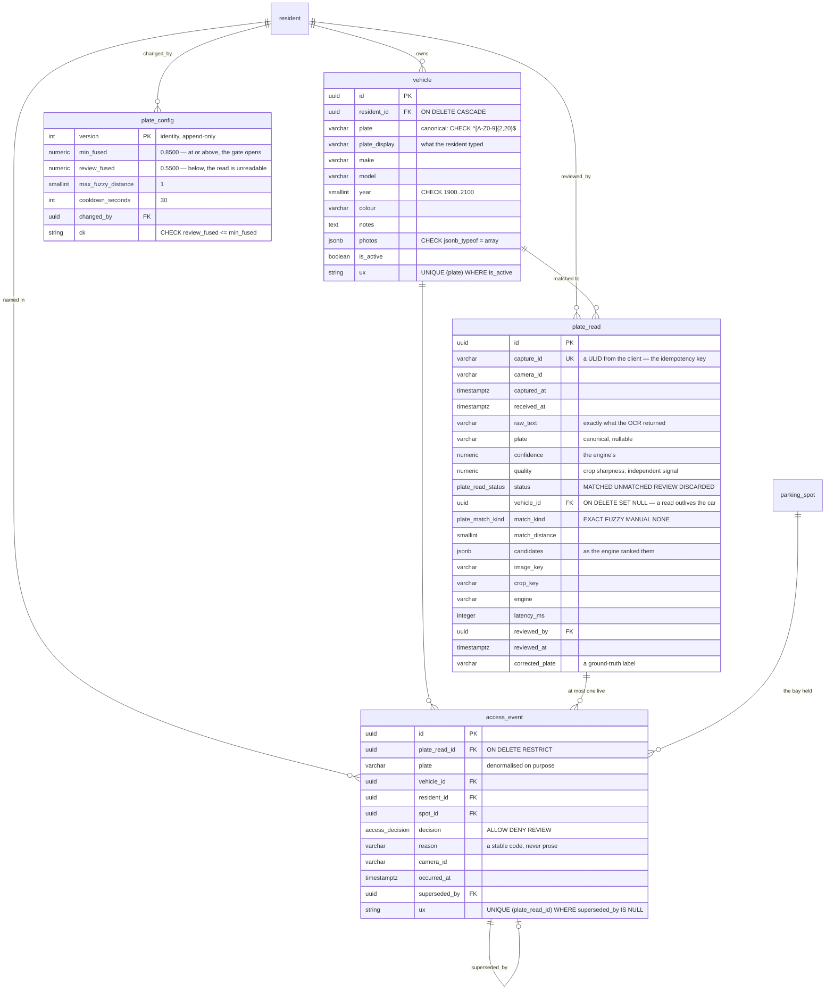

### 6.5 Things about the schema that are easy to get wrong

- **There is no `fairness_state` table.** The initial migration created one; the
  `waiting-time-fairness` migration drops it in `up` and recreates it only in `down`.
  Fairness is derived from `spot_assignment` and `allocation_history`, which is the whole
  point — there is no stored score to drift.
- **The registration table is `raffle_registration`**, not `cycle_registration`.
- **`allocation_cycle` has a `state` column**, not `status`.
- **The run lock is a partial unique index**: `CREATE UNIQUE INDEX uq_single_running_run ON
  allocation_run ((state)) WHERE state = 'RUNNING'`. It needs no infrastructure, holds
  across containers and deployments, and survives a process restart. A second concurrent
  run gets a unique violation, which the repository turns into `RunLockHeldError` and the
  use case into a 409.
- **The append-only privileges.** `app_user` — and therefore `pacs_app`, which holds it —
  has `UPDATE` and `DELETE` revoked on `allocation_history`, `allocation_run_candidate`,
  `allocation_config` and `plate_config`, and on `allocation_run` has `UPDATE` granted on
  six named columns only. On `access_event` it has `SELECT, INSERT` plus column-level
  `UPDATE (superseded_by)`: a decision is overturned by inserting a new row and pointing
  the old one at it, so the only mutable field is the link.
- **Plate thresholds live in `plate_config`, not `allocation_config`.** The allocation
  module builds each new policy version from the one in force and lists its own columns, so
  threshold columns sitting there would be reset to their defaults every time an
  administrator changed the period length. *(The doc comment at the top of
  `access-decision.ts` still says `allocation_config`; the migration and the provider say
  `plate_config`, and they are what runs.)*
- **Two plate columns, deliberately.** `plate` is the canonical key — uppercase, no
  separators, confusables folded (`O` and `Q` → `0`, `I` → `1`), defined once in
  `residents/domain/vehicle.ts`. `plate_display` is what the resident typed. Folding the
  display form would print "ABC 123" back with the O turned into a zero, and a resident who
  cannot find their own plate in the list stops trusting the list.
- **Plate uniqueness is partial on `is_active`.** The rule is "two residents cannot have
  the same plate registered at the same time", not "this plate may only ever be registered
  once in the history of the building" — otherwise a car sold to a neighbour could never be
  registered again.

---

## 7. The domain rules

### 7.1 Who does what

<!-- figure:page -->
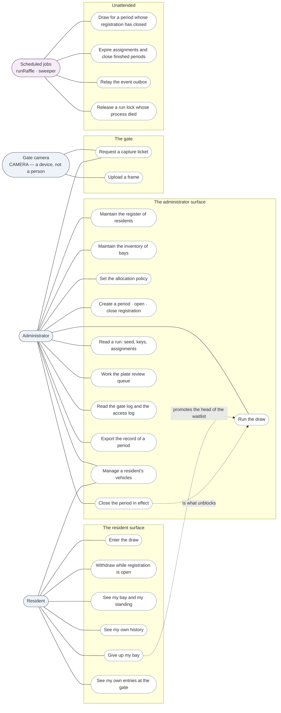

Two boundaries in that diagram are enforced rather than drawn:

- **An administrator has no resident surface.** They operate the draw, so they are never a
  party to it. The refusal exists three times over: `resident.is_admin` on the register row,
  the `ADMIN` role on the verified token (checked first, because the token is what actually
  grants the powers), and the snapshot query, which skips an admin row with the reason
  `ADMIN_ACCOUNT`. Administrators are also excluded from `GET /residents` — in the query,
  not in the client, so a page of fifteen is fifteen. The one exception is *withdrawal*,
  which is deliberately allowed: an account promoted to administrator after it had already
  registered needs a way out of a draw it may no longer enter.
- **A resident can only ever reach their own data.** `resolveResidentId` is the single place
  a caller's resident id is decided, and it comes from the verified token and nowhere else
  — never from a path, a query or a body. On the vehicle routes, where a path id is
  unavoidable, a resident asking for somebody else's record is answered `NOT_FOUND` rather
  than `FORBIDDEN`: a 403 would confirm the record exists, which turns the route into a way
  of enumerating residents.

### 7.2 The period state machine

<!-- figure:wide -->
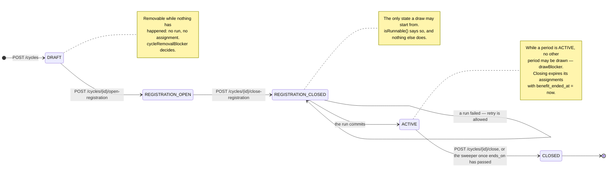

Every other transition is a 422 with the states named in the message. The table lives in
one constant, `CYCLE_TRANSITIONS` in `allocation/domain/cycle.ts`, and the assignment
lifecycle sits beside it: `ACTIVE → RELEASED | REVOKED | EXPIRED`, all three terminal and
all three kept distinct on purpose, because the termination policy reads them.

Two rules attach to the ends of that machine:

**A period can be removed only before it has had consequences** (`cycleRemovalBlocker`). If
it has handed out bays, or a draw has run, or it is ACTIVE or CLOSED, removal is refused and
the refusal says why in the words an administrator reads — "Allocation history is never
reset, so it cannot be removed. Close it instead when it ends." Before a draw it is a plan,
and a plan can be abandoned.

**A draw is refused while another period is in effect** (`drawBlocker`). This one was added
after the dev environment reached a state where 2026-Q4 and 2027-Q1 were both ACTIVE with
bay B1-08 assigned in both, to two different residents, and nothing in the system treated
that as wrong. It is worse than cosmetic: holding a bay moves a resident's waiting anchor,
so a second draw would reset the anchors of people whose benefit from the first has not
ended. The way forward is `POST /cycles/{id}/close`, which ends the period in effect and
expires its assignments with `benefit_ended_at` set to **now** rather than to `valid_until`
— because that is when the benefit actually stopped.

### 7.3 The draw

**This is rules A–F, deterministic. It is not a weighted lottery.** Sections 12 and 13 of
`docs/analisis.html` describe an earlier probabilistic model with accumulating scores; it
was replaced and is not what runs.

Three keys, compared in order:

1. **Longest effective waiting time first** (descending).
2. On a tie, **fewest past allocations first** (ascending).
3. On a remaining exact tie, **the raffle token**, ascending —
   `sha256(seed : runId : residentId)`, truncated to 128 bits.

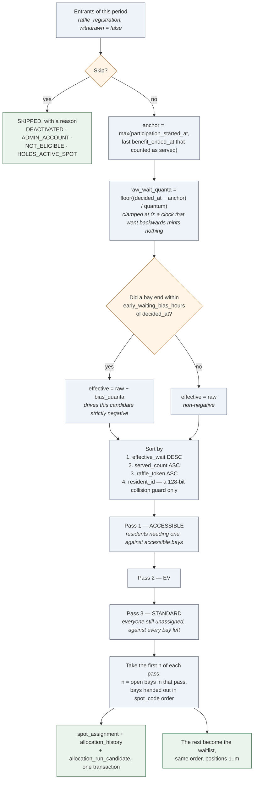

The parts of that worth defending:

- **Rule F is arithmetic, not a second comparison.** A resident whose bay ended very
  recently is "cooling": they rank below everyone whose wait is still running, including
  first-time participants. Implemented as a *subtraction* from the key rather than as a
  pairwise special case — because a resident is cooling exactly while their raw wait is
  below the bias window, the subtraction drives every cooling resident strictly negative and
  everyone else non-negative, and rule F becomes a theorem of the arithmetic. The pairwise
  reading admits a three-resident cycle, which would make the comparator non-transitive and
  the sort undefined. There is a regression test for exactly that cycle, and the pairwise
  version must never be implemented.
- **Which bay you get is not a lottery; only whether you get one is.** Bays are handed out
  in `spot_code` order within each pass.
- **Restricted pools run first and spill.** A resident who loses the accessible pass falls
  through to the standard pass with their key unchanged, and an accessible bay nobody
  claimed returns to the general pool — an empty accessible bay is worse than a
  standard-need resident parking in it.
- **The raffle token is derived from identity, never from position in the input array.** A
  resident can recompute their own token with `sha256sum` and three strings. That is the
  whole of the fairness proof offered, and it is enough.
- **The seed is drawn and persisted before the candidate list is read**, and
  `sha256(seed)` is stored as `seed_commitment` at the same moment. Re-rolling for a nicer
  result is therefore a hash preimage problem rather than an operational one.
- **`decided_at` is frozen once per run.** Never `Date.now()` inside the loop: two
  candidates' waiting times computed microseconds apart would make hour-bucket membership a
  race, and no replay could reproduce it.
- **The snapshot is read in one `REPEATABLE READ` transaction**, so a registration
  committed halfway through cannot produce a candidate list that no replay can reproduce.
- **The decision is pure and in memory; the transaction opens afterwards.** The database is
  held open only for the writes.

The policy values behind all of it live in `allocation_config`, are administrator-editable
and versioned, and appear as literals nowhere else in the codebase:
`allocationDurationMonths` (3), `earlyWaitingBiasHours` (24), `waitQuantumMinutes` (60),
`declineGraceHours` (48), `absenceResetMonths` (3, nullable), `totalBays` (0 = the whole
active inventory). `configWarnings()` surfaces legal-but-surprising combinations rather than
rejecting them — a bias wider than the allocation period would leave every previous holder
permanently cooling and freeze the ordering, which is a plausible and catastrophic typo.

**What counts as having been served** is one pure function, `terminationPolicy`, and it
writes one boolean, `counts_as_served`, once when an assignment terminates — so the hot
ranking query filters on a boolean and never reasons about reason codes:

| Termination | Counts as served? | Why |
|---|---|---|
| `EXPIRED` | yes | The normal path; the benefit ended when the period did |
| `RELEASED` | yes, from the moment it actually ended | A resident who gives a bay back on day 1 of 90 starts accruing on day 1. Parking days are traded for waiting days one for one; the brake on serial early release is the served count, which increments anyway |
| `REVOKED` | yes | They held and consumed the bay and lost it through their own conduct. Not resetting would reward misconduct with priority |
| `DECLINED` inside the grace window | **no** | Nothing was consumed. Penalising a free decline would make residents accept bays they cannot use, and an empty bay nobody may use is worse for everyone |
| `DECLINED` after the window | yes | It is an early release |
| `CANCELLED` with `make_whole` | **no** | Our mistake — admin error, building works — must not cost the resident their place in the queue |

### 7.4 Removal: the same line, drawn three times

| Rule | Where | The line |
|---|---|---|
| `cycleRemovalBlocker` | `DELETE /cycles/{id}` | A period with no run and no assignments can be deleted. Otherwise: close it |
| `spotRemovalBlocker` | `DELETE /spots/{id}` | A bay never assigned and not named by `allocation_history` can be deleted. Otherwise: retire it (`PATCH`), which takes it out of the inventory without touching what it is named in |
| `residentRemovalBlocker` | `DELETE /residents/{id}` | A resident named nowhere — no registration, no assignment, no history row, no config change, no reviewed plate read — is deleted outright. Otherwise the row is hidden and kept |

All three are pure functions with their own unit tests, all three return the sentence an
administrator is shown rather than a boolean, and all three exist for the same reason: the
schema puts `ON DELETE RESTRICT` on the audit paths, so the alternative to refusing early is
a foreign key violation surfacing as a 500. `DELETE /residents/{id}` answers 204 either way,
because the caller asked for the person to come off the register and that is what happened.

### 7.5 The gate decision table

One pure function, `decide()`, evaluated in this order — and the order *is* the function:

<!-- figure:page -->
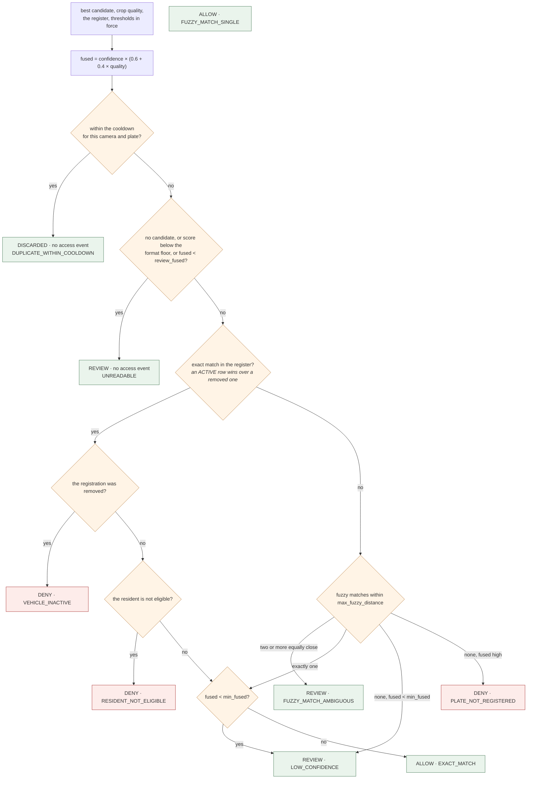

Three rows are worth defending, because in each one the obvious choice is wrong:

- **An unreadable frame produces no access event.** A `DENY` there would fill the log with
  refusals belonging to nobody and make the denial metric a measure of lens dirt. The frame
  is still recorded, because a camera that reads nothing for a day is a fault the review
  queue should surface.
- **An ambiguous fuzzy match never opens.** If two registered plates are equally close,
  opening means picking at random whose entry this was, and the log would then assert
  something untrue.
- **A clear read that is not registered is `DENY`, not `REVIEW`.** It is a visitor or an
  intruder: a fact, not a doubt. A visitor lane is a separate feature — a temporary plate
  with an expiry — and not a loosened threshold.

The thresholds (`0.85` and `0.55`) are a starting point and are labelled as one. They live
in `plate_config`, append-only, so recalibrating is an `INSERT` and not a deploy; the
environment variables are only the cold-start default. Every administrator correction in
the review queue writes a `corrected_plate`, which is a ground-truth label, which means the
evaluation set builds itself from day one.

---

## 8. Sequences

### 8.1 Signing in

Not the Cognito hosted page: the product owns the form, and `CognitoService` drives
`amazon-cognito-identity-js` with `USER_SRP_AUTH`, which proves knowledge of the password
without sending it.

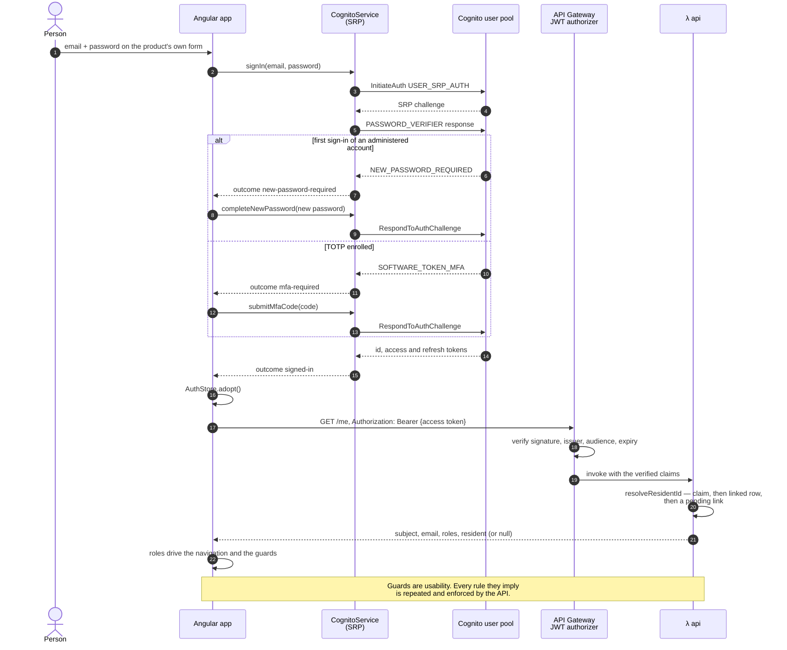

An access token lasts 15 minutes and `accessToken()` refreshes on demand, so a tab left
open overnight does not start returning 401s to a signed-in person. The roles the UI uses
come from `cognito:groups`; the resident record cannot be decoded from a token at all,
which is why `GET /me` is the only source of the principal.

### 8.2 A resident enters the draw

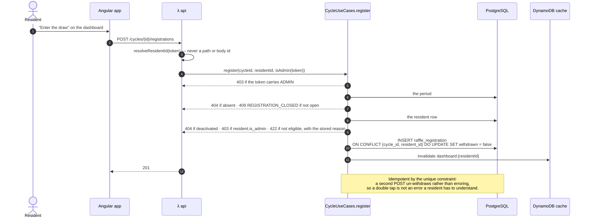

### 8.3 Running the draw

<!-- figure:wide -->
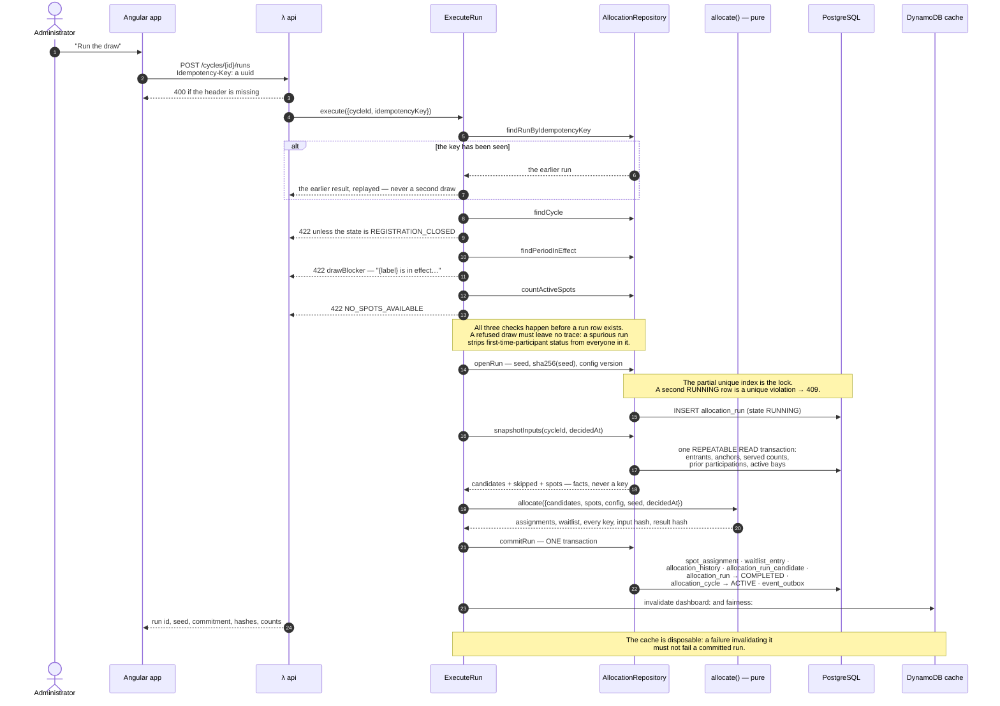

If anything throws after the run row exists, the run is marked `FAILED` with the detail and
the caller gets a 500 with a trace id. A run still `RUNNING` fifteen minutes later had its
process killed mid-flight; the sweeper fails it and frees the lock.

### 8.4 A plate at the gate, from frame to decision

<!-- figure:page -->
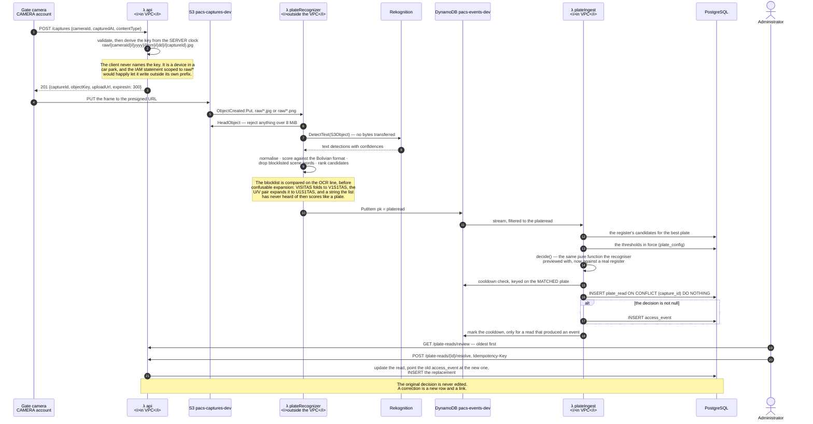

Idempotency happens in three layers, and only the middle one really matters: the
recogniser's conditional write, then `INSERT ... ON CONFLICT (capture_id) DO NOTHING` — the
DynamoDB stream delivers at least once, and a shard replay or a redeployed consumer both
land on that statement — and then the business cooldown, which is not idempotency at all
but dedupe: a car creeping towards the barrier is one arrival, not twenty.

### 8.5 Creating a resident, and how the Cognito user appears

The one flow where "no NAT gateway" is visible from the outside.

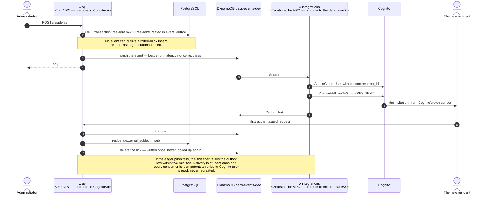

Measured end to end: the Cognito user exists about three seconds after the 201, and the
subject link about 1.5 seconds after that.

---

## 9. The API surface

Full contract: `packages/contracts/openapi.yaml`. Every route except `GET /health` requires
a bearer token. Every `{…id}` parameter is a UUID and is rejected before it reaches a query.

| Method and path | Role | Purpose |
|---|---|---|
| `GET /health` | public | Liveness |
| `GET /me` | any | The principal, from the token |
| `GET /me/dashboard` | resident | Aggregated status · cached 5 min |
| `GET /me/history` | resident | Own history |
| `POST /me/assignment/release` | resident | Give up a bay · promotes the waitlist head |
| `GET /me/access-events` | resident | Own entries at the gate |
| `POST /cycles/{id}/registrations` | resident | Enter the draw · idempotent |
| `DELETE /cycles/{id}/registrations/me` | any | Withdraw while registration is open |
| `GET` · `POST /residents` | admin | The register (administrators excluded) · create + provision |
| `GET` · `PATCH` · `DELETE /residents/{id}` | admin | Detail · edit · remove |
| `PATCH /residents/{id}/eligibility` | admin | Requires a reason |
| `PATCH /residents/{id}/participation-start` | admin | Correct the waiting anchor |
| `GET` · `POST /residents/{id}/vehicles` | admin · own | The resident's plates |
| `PATCH` · `DELETE /residents/{id}/vehicles/{vehicleId}` | admin · own | Edit · deactivate |
| `GET /vehicles/by-plate/{plate}` | admin | Gate lookup · normalises first |
| `GET` · `POST /spots` | admin | Inventory |
| `PATCH /spots/{id}` | admin | Edit or retire |
| `DELETE /spots/{id}` | admin | Remove a bay never assigned |
| `GET` · `PATCH /config/allocation` | admin | The policy in force · new version |
| `GET /config/allocation/history` | admin | Who changed what, and when |
| `GET` · `POST /cycles` | admin · resident reads | Periods |
| `PATCH` · `DELETE /cycles/{id}` | admin | Rename (the only editable field) · remove |
| `POST /cycles/{id}/open-registration` | admin | DRAFT → REGISTRATION_OPEN |
| `POST /cycles/{id}/close-registration` | admin | → REGISTRATION_CLOSED |
| `POST /cycles/{id}/close` | admin | End the period in effect; expires its assignments |
| `POST /cycles/{id}/runs` | admin | Run the draw · `Idempotency-Key` required |
| `GET /runs` · `GET /runs/{id}` | admin | Runs, and one run with its seed and commitment |
| `GET /runs/{id}/explanation` | admin | The paragraph a contesting resident is shown |
| `GET /runs/{id}/assignments` | admin | The full result set |
| `GET /metrics/fairness` | admin | Dashboard · cached 10 min |
| `GET /metrics/plates` | admin | Match rate, queue depth and age, corrections · cached 10 min |
| `GET /reports/quarterly/{cycleId}` · `/reports/period/{cycleId}` | admin | Export · `?format=csv` |
| `POST /captures` | **camera** · admin | A presigned PUT for one frame |
| `GET /plate-reads` | admin | The gate log, newest first |
| `GET /plate-reads/review` | admin | The review queue, **oldest** first |
| `GET /plate-reads/{id}` | admin | One read, its candidates, and 5-minute image URLs |
| `POST /plate-reads/{id}/resolve` | admin | Review · `Idempotency-Key` required |
| `GET /access-events` | admin | The access log · `?format=csv` |

Errors use one shape, with a `traceId` that matches the log correlation id:

```json
{
  "error": "RAFFLE_IN_PROGRESS",
  "message": "An allocation run is already executing for this cycle.",
  "traceId": "7b4e...",
  "timestamp": "2026-03-26T02:00:00Z"
}
```

Two cross-cutting conventions. **Paging is keyset**, with a `limit` capped at 100 and a
`nextCursor`; offset paging would shift rows under an administrator working a queue.
**`Idempotency-Key` is required** on the two routes where a retried click would otherwise
write a second irreversible decision: running a draw, and resolving a plate read.

---

## 10. Running it locally

```bash
cd code
pnpm install          # also points git at .githooks through the root `prepare` script
```

### No AWS, no database, no deploy

```bash
pnpm --filter @pacs/api local     # the stub API on http://localhost:4300
cd apps/web && pnpm offline       # http://localhost:4200
```

`scripts/local-api.mjs` is an in-memory implementation of the same contract, seeded with 72
residents, 56 bays, four periods, a vehicle register and a gate log with reads waiting in
the review queue. It is a *fixture*, not a second implementation: when a shape there
disagrees with `openapi.yaml`, the YAML wins and the stub is the bug. Its bearer token is
`local.<base64url json>` with no signature, accepted only by it — the deployed API rejects
such a token at the Cognito authorizer before any handler runs. Sign in as `admin@local` or
`resident@local` with any password.

This is the loop to use for almost all work. It is also what the Playwright suite runs
against.

### Against the real database

Export a connection string once per shell. Nothing is committed and no password is passed
on a command line:

```powershell
$s = aws secretsmanager get-secret-value --secret-id dev/hotel-db/connection `
       --profile hotel --region us-east-2 --query SecretString --output text | ConvertFrom-Json
$env:DATABASE_URL = "postgresql://$($s.username):$([uri]::EscapeDataString($s.password))@$($s.host):$($s.port)/pacs_dev?sslmode=no-verify"
```

This only works from a machine the security group admits — see §5.

```bash
pnpm --filter @pacs/api migrate:up
pnpm --filter @pacs/api seed                       # 24 residents, 10 bays, one open period
pnpm --filter @pacs/api exec tsx scripts/run-draw.ts
```

`run-draw.ts` wires the real repositories to the real use case and asserts the things only
Postgres can prove: the run lock, the uniqueness constraints, the waitlist having no gaps,
the period moving to ACTIVE, and that `app_user` cannot `UPDATE allocation_history`.

---

## 11. Deploying

Two engines, and the split is forced rather than chosen.

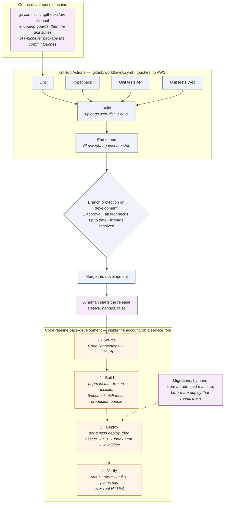

**Why Actions cannot deploy.** This account sits under an organisation whose service control
policy denies every IAM action on identity providers — creating one, and even reading one.
Keyless GitHub OIDC federation into the account is therefore impossible, and the
alternative, an IAM user whose access keys live in a public repository's secrets, is a
long-lived credential nobody should have to rotate. CodePipeline runs inside the account on
a service role and needs no federation at all.

**Why CodePipeline cannot replace Actions.** It starts after a merge. By then there is
nothing to stop. Only a check reported on the pull request itself can prevent bad code
landing, which is what the six Actions checks are for — and they need no AWS credentials, no
network beyond the registry, and are therefore safe to run on a pull request from a fork.

**Why the pipeline is manual-start.** `DetectChanges: false` on the source action. A merge
into `development` lands the code and nothing else happens until somebody releases it, so a
merge can never surprise the environment somebody is demonstrating on. It is a V2 pipeline,
so an execution can be started against a chosen commit with `--source-revisions`, which is
how a loose branch gets tried on the development environment without opening a pull request.

Other things about the pipeline worth knowing before changing it:

- **The Build stage repeats the unit tests Actions already ran.** Deliberately: branch
  protection can be bypassed by an administrator, and on this project the administrator is
  also the only engineer. A pipeline that trusts a check it did not run will one day deploy
  something that does not compile. A minute of CodeBuild buys that away. What is *not*
  repeated is Playwright — its whole purpose is to block a merge, and after the merge it
  blocks nothing.
- **The artefact carries no `node_modules`.** pnpm builds them out of symlinks into a
  content-addressed store, and those do not survive being zipped and unzipped in another
  container. The deploy stage reinstalls from the same lockfile, which costs about thirty
  seconds and is reproducible.
- **Backend before frontend, always.** A frontend that went up first would, for the length
  of the deploy, be a new client calling an old server.
- **Hashed assets first with a one-year immutable cache, `index.html` last with
  `no-store`.** If `index.html` went up first it would briefly point browsers at chunks that
  are not there; if it were cached like the chunks, a returning visitor would never see the
  deploy at all.
- **The build role is `PowerUserAccess` plus a narrow inline IAM policy**, scoped to
  `pacs-api-*` roles, with an explicit `Deny` on anything named `pacs-pipeline-*` so it can
  never rewrite its own trust or permissions. Enumerating every action `serverless deploy`
  may emit is a policy nobody can keep correct, and getting it wrong surfaces as a deploy
  that dies half-applied.

To deploy by hand from an admitted machine:

```bash
cd apps/api
pnpm --filter @pacs/api migrate:up                      # if there are new migrations
serverless deploy --stage dev --aws-profile hotel --region us-east-2
node scripts/smoke.mjs
```

### Two things that will bite on a fresh deploy

**Handler filenames must contain no dots.** The bundle is flattened and the Node runtime
splits the handler string at the *first* dot, so `src/main/api.handler.ts` with handler
`src/main/api.handler.handler` fails at init with `Cannot find module 'api'`.

**An S3 trigger on a bucket the same stack creates is a circular dependency.** The bucket
needs the function's ARN for its notification, the function's invoke permission needs the
bucket, and CloudFormation refuses the loop. It is broken by giving
`PlateRecognizerLambdaPermissionS3` a **literal** `SourceArn` string rather than
`!GetAtt CapturesBucket.Arn`. The same applies to the S3 statements in the service role.
After a deploy, confirm the trigger actually attached — this is the step that silently
fails:

```bash
aws s3api get-bucket-notification-configuration \
    --bucket pacs-captures-dev --profile hotel --region us-east-2
```

---

## 12. Test strategy

Five layers, each answering a question none of the others can.

| Layer | Command | Size | What only it can prove |
|---|---|---|---|
| Unit, API | `pnpm --filter @pacs/api test` | **231 tests in 21 files**, about 3 s | The rules. The draw is run ten thousand times with seeded inputs to check it is *fair*, not merely that it runs; the whole plate threshold table is a set of table tests |
| Unit, web | `pnpm test` in `apps/web` | **29 tests** | The boundary between DTO and model — the mappers, where a contract change actually bites |
| End to end | `pnpm e2e` in `apps/web` | 2 specs, Playwright, Chromium | That the screens work, against the in-memory stub. One worker, because both servers hold a single in-memory building |
| Post-deploy smoke | `node scripts/smoke.mjs` + `smoke-plates.mjs` | 31 checks + the plate pipeline | That the *deployed* system works. The only layer that can speak for Cognito, for Postgres, or for whether a frame put in an S3 bucket comes back out as a recognised plate |
| Integration, by hand | `tsx scripts/run-draw.ts` | 16 checks | The things only Postgres can prove: the run lock, the constraints, the privilege revocation |

Properties of the suites worth keeping:

- **The statistical suite is the unusual one, and it is the point.** `priority-key.properties.spec.ts`
  asserts transitivity, the uniformity of the raffle across a k-way tie, and the
  three-resident cycle that the pairwise reading of rule F would produce.
- **The plate suite is the same argument applied to a different problem**, including the
  regression that matters most: `VISITAS` canonicalises to `V1S1TAS`, the U/V confusable
  pair expands that to `U1S1TAS`, and a string the blocklist has never heard of then scores
  like a plate. The blocklist is therefore checked on the OCR line, before expansion.
- **The E2E suite deliberately does not run against AWS.** It would be slower, cost a
  Rekognition call and a stored frame per run, fail whenever somebody else was using the dev
  environment — and, as this project found out, it leaves rows behind: a smoke suite once
  invented a period called `2235-Q1` that then drove the administrator's "ready to draw"
  banner on a real screen.
- **The smoke suites clean up after themselves as far as they can.** The Cognito users are
  deleted on every run; the fixtures are taken down through the API with the administrator's
  token — the period deleted, the resident deactivated, the bay retired. Two inert rows per
  run remain, because removing those means reaching the database, and CodeBuild cannot
  (§5). `scripts/clean-smoke-data.mjs` clears them from an admitted machine.
- **The draw is not run in the pipeline.** A committed run is a record, and
  `cycleRemovalBlocker` refuses to delete a period that has one, so running the draw there
  would make the test period permanent. The write path is covered by the unit tests instead.
  Set `DATABASE_URL` and the suite runs the draw and clears it afterwards — which is what a
  developer gets and the pipeline deliberately does not.

---

## 13. Known constraints and gaps

Each of these is a decision forced by the real account, or an acknowledged absence. None of
them is a surprise waiting to be found.

**Forced by the environment**

| | |
|---|---|
| Region | `us-east-2` only. SCP `p-wvjo6arp` denies every other region |
| Identity federation | No GitHub OIDC provider is possible: the SCP denies every IAM action on identity providers. This is the whole reason deployment runs on CodePipeline |
| Lambda concurrency | Quota is 10, and AWS requires 10 unreserved, so no function can reserve any. The quota bounds the connection pool at 10 × 2 = 20 |
| Database | Shares the existing `hotel-db` (PostgreSQL 18.3, `db.t4g.micro`, single-AZ, backup retention **1 day**); `pacs_dev` is its own database. The specification asks for a dedicated instance and 7-day backups |
| Network | The default VPC, the default security group, public subnets, and a publicly accessible instance admitting one `/32`. Requested, so migrations run from a laptop. Reverting is two commands |
| Migrations | Not in the pipeline: CodeBuild cannot reach the database. Applied by hand before the deploy that needs them. The intended answer is a migration Lambda inside the VPC that the Deploy stage invokes |
| TLS to the database | `rejectUnauthorized: false` — the RDS CA bundle is not shipped in the Lambda bundle. Encrypted, not verified. `verify-full` with the RDS global bundle is on the gap list |
| Serverless Framework v4 | Needs a vendor access key in CI, read from Secrets Manager. Free for individuals and for organisations under the vendor's revenue threshold; confirm the licence before using it for a company account |

**Not built**

- SES notification templates. `integrations` already receives the allocation events and logs
  them; only the templates and the send call are missing. SES is in sandbox
  (`ProductionAccessEnabled: false`, 200/day), so it can only send to verified addresses.
- The plate crop writer. `plate_read.crop_key`, the `crops/` IAM statement and the lifecycle
  rule all exist, but nothing writes a crop: cropping needs a native image decoder in the
  bundle, and the review screen reads the full frame instead.
- A capture client. `POST /captures` is the contract a gate camera would call; no camera
  firmware or web capture page is written.
- Threshold calibration. The procedure and the storage exist; the week of shadow operation
  that produces real numbers has not happened, so `0.85` and `0.55` are a labelled starting
  point.
- Transloco is installed but not wired. Spanish and English are required. One sentence
  resists it: the fairness explanation comes back from the API as finished prose rather than
  a message key plus parameters, so it cannot be localised without changing the contract.
  That is the one real design debt on the frontend. The plates module deliberately does not
  repeat the mistake — `access_event.reason` is a stable code and the wording lives in
  `features/plates/reason-label.ts`.
- `absenceResetMonths` is stored and validated but nothing triggers it.
- No k6 load suite.

**Where the repository's own documents are out of date**

- `README.md` reports 213 unit tests; there are 231. It also still says "`git init` — this
  is not a repository yet" and lists CI as not built. Both have since happened.
- `docs/analisis.html` sections 12 and 13 describe the probabilistic weighted lottery that
  rules A–F replaced. Section 10 still says `us-east-1`, private subnets, per-function IAM
  roles, a master password in SSM and the `*.handler.ts` filename convention — none of which
  is what runs.
- `pipeline/dev/buildspec-deploy.yml` says RDS is in private subnets. It is not; the
  conclusion it draws is still right, but for the security group's reason, not the subnet's.
- The doc comment at the top of `plates/domain/access-decision.ts` says the thresholds are
  read from `allocation_config`. They are read from `plate_config`.
