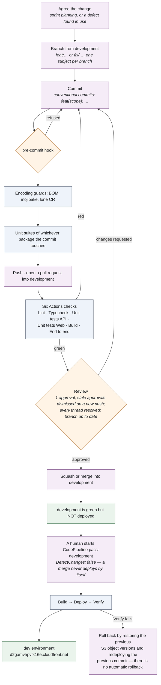
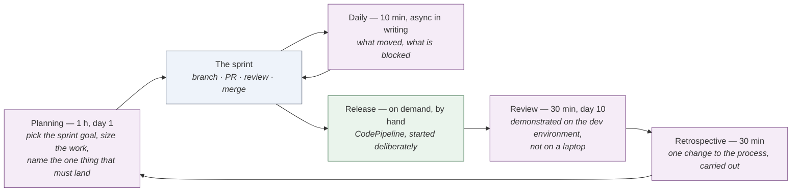
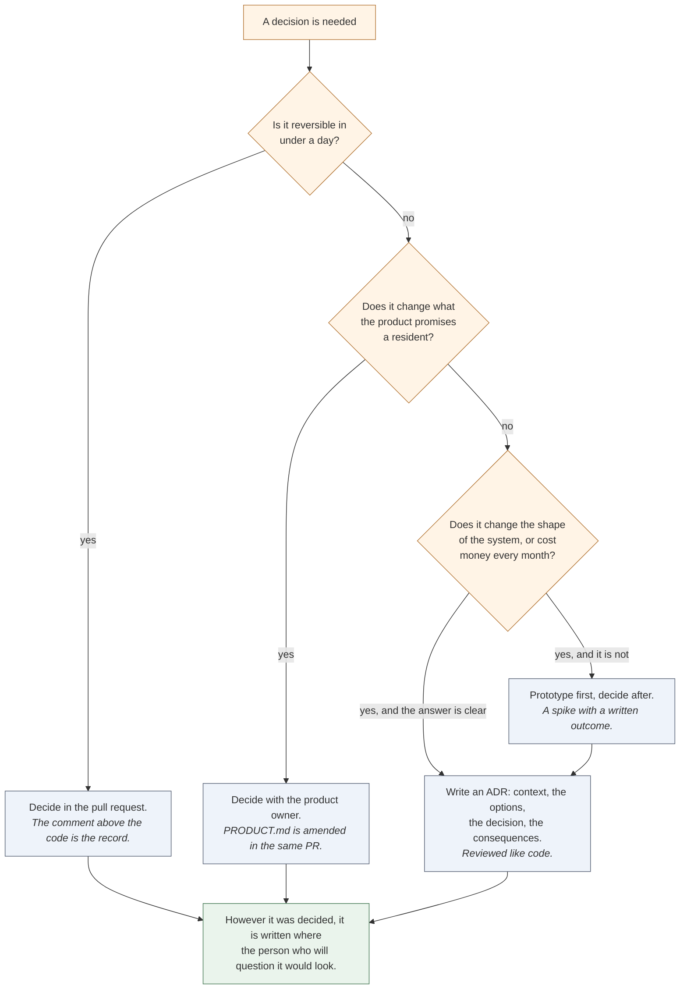

# PACS — Communication plan

How the team stays aligned: how work is agreed, how it is reviewed, how it is released, and
where a decision lives once it is taken.

This is a description of what this repository actually enforces, not a template. Every
mechanism named below exists in the project — in `.github/workflows/ci.yml`, in the branch
protection on `development`, in `.githooks/pre-commit`, in the CloudFormation under
`pipeline/dev/`, or in the comments in the source. Where something is a proposal for when
the team grows past one engineer, it says so.

---

## 1. The current shape of the team, stated honestly

One engineer is building this, as a promotion assessment, and the same person holds the
GitHub administrator rights. That matters for two reasons, and both of them have shaped the
mechanics:

- **The process is designed so it keeps working when a second person arrives.** Branch
  protection requires an approving review even though there is nobody else to give one. The
  rule is not theatre: it is the thing that must already be true on the day the team is
  two, and a rule introduced later always arrives as an accusation.
- **No gate is trusted just because somebody promised to run it.** `enforce_admins` is off,
  so the administrator *can* bypass branch protection. The Build stage of the pipeline
  therefore re-runs the type check and the API unit suite rather than trusting the Actions
  run that preceded it. A pipeline that trusts a check it did not run is a pipeline that
  will one day deploy something that does not compile; a minute of CodeBuild buys that away.

Everything below is written for the team this becomes, with the places where one person
plays both parts marked.

---

## 2. The path a change takes

<!-- figure:page -->

Three properties of that path are worth naming, because they are what the team actually
relies on:

**A merge is not a release.** `DetectChanges: false` on the pipeline's source action means
`development` can be merged into all day without the environment moving. Somebody releases
deliberately. The practical value shows up on the day a demonstration is running: nobody
has to ask the rest of the team to stop merging.

**The gate is on the pull request, not after it.** CodePipeline starts after a merge; by
then there is nothing to stop. That is exactly why the six checks live in GitHub Actions
and why none of them touches AWS — they need no credentials, no OIDC role and no network
beyond the registry, which is also what makes them safe to run on a pull request from a
fork of a public repository.

**The local hook is a courtesy to the reviewer, not a substitute for the checks.** It runs
the unit suites of whichever package the commit touches, so a commit that edits only the
pipeline templates or a document pays nothing. `git commit --no-verify` exists for a
deliberate work-in-progress commit, and using it is not a transgression — the pull request
will still be told.

---

## 3. Code review

### 3.1 What the machine checks, so a human does not have to

Branch protection on `development`, as configured today:

| Setting | Value |
|---|---|
| Required approving reviews | **1** |
| Stale approvals dismissed on a new push | yes |
| Required conversation resolution | yes |
| Required status checks | **Lint · Typecheck · Unit tests API · Unit tests Web · Build · End to end** |
| Branch must be up to date before merging | yes |
| Force pushes · branch deletion | both refused |
| Administrators included | **no** — the one deliberate escape hatch, covered by the pipeline re-running the suites |
| Required signatures · linear history | not enforced |

Plus, before a commit even exists, `.githooks/pre-commit`:

1. **No UTF-8 BOM** in a staged `.json`, `.ts`, `.mjs`, `.js`, `.yml`, `.yaml` or `.md`.
2. **No doubly-encoded UTF-8**: UTF-8 bytes read as Latin-1 and written back as UTF-8, so
   an em dash arrives as three characters beginning with a circumflexed lower-case a, and
   a section sign as two beginning with a circumflexed upper-case A. The hook's regular
   expression lists the exact sequences; this document deliberately does not, because it
   would then be a file the hook refuses.
3. **No carriage return outside a CRLF pair.**
4. Then the unit suites of the packages the commit touches. `packages/` counts as touching
   both.

All three encoding guards exist because all three defects actually happened here. A BOM on
`package.json` made Vite refuse to parse it with an error that named no file, and cost one
red pull request. The mojibake reached `apps/api/package.json`'s description and, unlike a
BOM, stays visible in the file for anyone to read. The lone carriage return is the worst of
the three: git's `text=auto` detection treats one as a sign of a binary file, so the
`eol=lf` in `.gitattributes` stops applying, and four admin pages ended up classified as
binary — one of them with a CR sitting where the "r" of "resident" belonged, inside a
comment, invisible. The encoding checks run *before* the suites, because a BOM is a one-line
fix and waiting out the tests to be told about it is twenty seconds spent learning nothing.

The hook is version-controlled rather than living in `.git/hooks`, and `pnpm install` points
git at it through the root `prepare` script. A fresh clone gets it by installing.

### 3.2 What a human is for

The machine has already established that it compiles, lints, passes 231 API tests and 29
web tests, builds, and survives Playwright. A review that re-checks any of that is wasted.
What a reviewer is actually reading for, in rough order of value on this codebase:

1. **Is the rule in the right ring?** Business rules belong in `domain/`, pure and
   synchronous. The clearest review comment this project has produced is "this is a
   decision, and it is in `infrastructure/`". The snapshot query is a standing example of
   the rule: it emits facts — anchors, counts, flags — and never a priority key, because
   duplicating the key formula in SQL and TypeScript would guarantee drift, and the drift
   would be invisible until a resident compared their dashboard with the run page.
2. **Does the comment say *why*?** The convention here is heavier than usual and it is
   deliberate: a comment that restates the code is noise, a comment that records the
   alternative that was rejected is the only durable place that reasoning lives. If a change
   makes a non-obvious choice and the diff does not explain it, that is a review comment,
   and it is the most common one.
3. **Is there a test next to the code?** `*.spec.ts` beside the file it tests. A new domain
   rule without one is incomplete, not "to be followed up".
4. **Does it widen a boundary?** New route, new role check, new IAM statement, new column
   on an append-only table, anything that makes an identifier reachable from a path. These
   get read twice.
5. **Would a resident understand the refusal?** Every blocker in this codebase returns the
   sentence an administrator is shown, not a boolean. A new one that returns `false` is
   sending somebody to support.
6. **Is the change one subject?** The seven pull requests merged so far run from 23 to
   1,367 lines changed, each with a single subject in its title. A branch that has
   accumulated two subjects is two pull requests.

### 3.3 How review is conducted

- **Review on the pull request, in threads, never over a call alone.** A decision reached
  verbally and merged leaves the next person reading the diff with no explanation. If a call
  is the fastest way to resolve something, the outcome goes back into the thread before the
  merge — which is also what "required conversation resolution" is there to make habitual.
- **A comment states the problem, the location and the suggested fix.** Three lines. Review
  prose costs the author time to parse and the reviewer nothing to omit.
- **Distinguish a blocker from a preference out loud.** "This must change before merge"
  and "I would have done this differently" are different sentences and should look
  different. Anything that is a preference and still worth saying is said once and then
  dropped.
- **The author resolves threads, the reviewer confirms.** The branch cannot merge until
  every one is resolved, so an unresolved preference is an accidental blocker.
- **An approval is for the commit that was approved.** A new push dismisses it. That is a
  setting, not a courtesy.
- **While the team is one person**, the review step is self-review against this list, on
  the pull request page, with the comments written down. Reading one's own diff as a
  reviewer rather than as an author catches a surprising amount, and it leaves the record
  that makes the second engineer's first review feel normal rather than ceremonial.

### 3.4 What gets written where

| The change | Where the reasoning goes |
|---|---|
| Why this code is shaped this way | A comment above it. This is the default and it is the strongest convention in the repository |
| Why this product rule exists | `apps/web/PRODUCT.md` — users, jobs, the mechanism, the durable constraints |
| Why this technology, at the scale of the whole system | An ADR in `docs/analisis.html`. ADR-014 lambdalith, ADR-016 no NAT, ADR-017 DynamoDB as cache, and so on |
| Why this release did what it did | The pull request body and the conventional commit subject |
| Why the deployed reality differs from the specification | The deviations table in `apps/api/README.md`, and §13 of the technical documentation |

The rule behind the table: **a decision is not made until it is written somewhere a stranger
would find it.** The place is chosen by who needs it — a reader of this line of code, a
reader of this product, or a reader of this architecture.

---

## 4. Sprint planning

A two-week cadence. The ceremonies below are deliberately few; on a team this size the
expensive failure is not under-planning, it is spending a morning agreeing what everyone
already knew.

### What planning actually decides

**The sprint goal is one sentence naming an outcome, not a list of tickets.** The ones this
project has actually had read like "a run leaves no row at all" and "the Verify stage leaves
nothing an administrator can see" — both of which are pull request titles, because the
sprint goal and the change that satisfies it should be recognisably the same thing.

**Work is sized by risk, not by hours.** Three buckets:

- *Known* — the shape is clear, the tests are obvious. Estimate and commit.
- *Known-shaped but unmeasured* — the approach is clear and a number is not, usually
  because it touches AWS. Timebox it and report what was learned.
- *Unknown* — a spike with a written outcome and no deliverable code expected. The
  threshold calibration described in `MODULO-PLACAS.md` §8 is one of these: a week of shadow
  operation producing numbers, not a feature.

**Anything that touches the deployed environment is planned with its rollback.** There is no
automatic rollback in the pipeline. The S3 bucket is versioned with a 30-day noncurrent
expiry *specifically* so a bad frontend deploy can be undone by restoring the previous
objects; a bad backend deploy is undone by redeploying the previous commit. A plan that does
not say which of those applies is not finished.

**Migrations are planned as their own step, with a named person and a named machine.** They
are not in the pipeline and cannot be: CodeBuild sits outside the VPC and its address
changes every run, so the security group on `hotel-db` cannot admit it. A sprint containing
a migration has an explicit item that says who runs `migrate:up`, from where, and *before
which deploy*. This is the single most likely way for this project to break its own
environment, and it is the reason the item exists.

**Carry-over is discussed, not hidden.** A branch open across a sprint boundary is reported
at planning with what it is waiting on. The branch protection requires an up-to-date branch
before merge, so a long-lived branch becomes somebody's rebasing problem, and the cost grows
quietly.

### The backlog

Items live in Jira. An item is ready for a sprint when it has: the outcome in a sentence,
the rule or the screen it touches, and the observable that says it is done. "Observable"
means a test, a command, or a thing a person can see on the dev environment — the same
standard the Verify stage holds itself to.

Three standing sources of backlog items, each of which has already produced real work:

1. **The gap list** — §13 of the technical documentation, and the "Not built yet" section
   of `apps/api/README.md`.
2. **Defects found in use.** Two periods ACTIVE at once with the same bay assigned to two
   residents was found by looking at the dev environment, not by a test. It became
   `drawBlocker` and `POST /cycles/{id}/close` in a single sprint item.
3. **The comments.** Several comments in the source name the follow-up explicitly — the
   migration Lambda inside the VPC, `verify-full` TLS to the database, the crop writer,
   wiring Transloco. These are backlog items that have already been written; they only need
   lifting.

---

## 5. How decisions get made

### The rules behind that diagram

**Reversibility sets the ceremony.** Most decisions are cheap to undo and should be made by
whoever is holding the keyboard, with a comment explaining the alternative they rejected.
Spending a meeting on a one-day decision costs more than being wrong about it.

**An expensive decision gets written down before it is taken, not after.** An ADR here has
four parts and no more: what the situation is, what the options were, what was chosen, and
what that costs. The consequences section is the one that earns its keep — ADR-016's "no
NAT gateway" consequence is "an in-VPC function reaches exactly RDS and DynamoDB", and every
strange thing about this architecture descends from that one line. An ADR that lists only
benefits has not been written yet.

**A constraint the account imposes is recorded as a constraint, never as a preference.**
The deviations table in `apps/api/README.md` has a "Why" column for exactly this, and some
of its rows are not flattering: `us-east-2` because an SCP denies everything else; CodePipeline
because an SCP makes OIDC impossible; no reserved concurrency because the account quota is
10. A reader who cannot tell a forced constraint from a design choice will undo the
constraint and break the system.

**Disagreement is resolved by making it concrete.** Two defensible options and no evidence
is a spike, not a debate. The engine choice for plate recognition is the model: three
options were costed per read, the expensive one was chosen for reasons that were written
down (no second language in the monorepo, no AGPL obligation, no 8-to-15-second cold start
failing the first car of the day), and the whole thing was put behind a port so that being
wrong costs one class in `infrastructure/` and one line in `src/main`. **Designing so the
decision can be revisited is usually cheaper than getting it right first time.**

**A decision stays open until somebody can state what would change it.** `PRODUCT.md` has an
"Open" section carrying exactly this — whether accessible-bay handling stays in the product,
and what reactivation should do for a resident who leaves and returns. Writing a question
down as open is a decision; leaving it undiscussed is not.

**Decisions are revisited when the evidence arrives, and the revision replaces the
original.** The fairness model is the example that matters: `docs/analisis.html` sections 12
and 13 describe a probabilistic weighted lottery that was superseded by the deterministic
rules A–F. The lesson the team took from it is in this plan: when a decision is replaced,
the superseded text must be marked as superseded where it lives, or the next reader
implements it.

---

## 6. Communicating outside the team

| Audience | What they need | How it reaches them |
|---|---|---|
| The building administrator | What changed on the screens they work in, and anything that changes how a draw behaves | Release notes written from the merged pull request titles, sent when the pipeline's Verify stage passes — never when the merge happens, because a merge is not a release here |
| A resident | Nothing, routinely. A change to the allocation rules is the exception | The fairness explanation the product already generates (`GET /runs/{id}/explanation`), plus a notice from the administrator. A policy change is a new `allocation_config` version with `changed_by` and `changed_at`, so the record of what changed and when exists whether or not anybody writes a notice |
| A resident contesting a result | The arithmetic, not a policy | `GET /runs/{id}` gives the seed and its commitment; `/explanation` gives the paragraph; the raffle token is `sha256(seed:runId:residentId)` and they can recompute it themselves |
| Evaluators and reviewers of this project | Why, far more than what | This documentation set, the ADRs, and the comments — which is why the comment convention is treated as a deliverable rather than as a nicety |

---

## 7. What is deliberately not in place yet

Named so that nobody mistakes an absence for an oversight.

- **No `CODEOWNERS` file and no pull request template.** Both are one-person-team noise
  today and both should land on the day the team is two: `CODEOWNERS` so the right person is
  requested automatically, and a template so "what did you consider and reject" is a field
  rather than a habit.
- **`enforce_admins` is off.** It should go on when the team is two. Until then, turning it
  on would mean no change could ever be merged.
- **No scheduled dependency updates.** `pnpm install --frozen-lockfile` everywhere means the
  lockfile is the contract, which is the right half of the problem; nothing currently
  proposes raising it.
- **No alerting route off the two CloudWatch alarms.** They exist and they fire into the
  console; nobody is paged. A dev environment does not warrant it, and the day one of these
  stacks carries a real building, it does.
- **No status page or incident process.** The same judgement, for the same reason.
