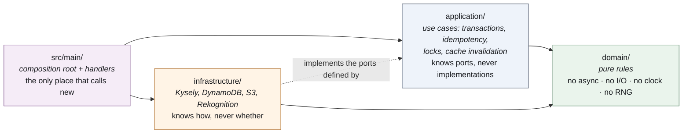

# PACS — Onboarding guide

For a developer joining the project. The goal of this document is narrow: to get you from a
fresh clone to a merged pull request, understanding why the code looks the way it does
rather than only where things are.

It should take about a day to work through. Nothing here asks you to read the whole
codebase, and nothing here asks you to deploy anything.

---

## 1. Before anything: what the product is, in sixty seconds

A residential building has fewer parking bays than residents. PACS hands them out on a
recurring period — three months by default — by one stated rule, and keeps enough of a
record that a resident who did not get a bay can be shown exactly why.

The rule, in full:

1. Whoever has waited longest goes first.
2. On a tie, whoever has had the fewest bays in the past goes first.
3. On a remaining exact tie, a seeded draw decides.

That is the core of the fairness policy. Two rules sit on top of it, and both only move
the start of a resident's wait: giving a bay up — withdrawing, declining, releasing — costs
what holding one costs, and sitting a period out restarts the clock. The technical
documentation states all eight rules, A to H, in one table (§7.3). It is not a lottery with weights, and if you find a
document in this repository describing one — `docs/analysis.html` sections 12 and 13 —
you have found a superseded design.

Two vocabulary notes, because they are enforced in code review:

- In the user interface it is a **bay**, never a "spot". In the database and in the code it
  is `parking_spot`, because renaming the schema was not worth the migration. Both are
  correct in their own place.
- A resident is **removed** from the register, never "deleted". Allocation history is never
  reset, because past draws must stay explainable.

---

## 2. What to read, in this order

Stop after each one and let it settle. Items 1 to 5 are the day; 6 and 7 are for when you
need them.

| # | Read | Why this, now | Time |
|---|---|---|---|
| 1 | `apps/web/PRODUCT.md` | The shortest statement of who the users are, what they need, and what may never change. 80 lines | 10 min |
| 2 | `docs/delivery/01-technical-documentation.md` §1–§3 | What the system is, how the repository is laid out, and the two architecture diagrams. Do not try to absorb the AWS sections yet | 30 min |
| 3 | `apps/api/src/modules/allocation/domain/priority-key.ts` | 130 lines, and the heart of the product. Read every comment. If you understand this file you understand the thing PACS is judged on | 30 min |
| 4 | `apps/api/src/modules/allocation/domain/allocate.ts` | How that key becomes an allocation: one sort, three passes, and the hashes that make a run contestable | 20 min |
| 5 | `apps/api/src/main/routes.ts` | The whole API surface in one file, with the two authorisation guards that a route's role list cannot express. Skim the presentation functions; read the guards properly | 30 min |
| 6 | `apps/api/migrations/1759600000000_init-schema.ts` and `…_waiting-time-fairness.ts` | The schema, as raw SQL with the reasoning in comments. The second one is also a worked example of expand / migrate / contract in a single migration | 30 min |
| 7 | The root `README.md`, especially "Where this deviates from analysis.html" | Why the deployed reality differs from the specification. Every row is a constraint, not a preference | 15 min |

**Deliberately not on that list:** `docs/analysis.html`. It is the original specification,
it is 280 kB, and parts of it have been superseded by the code. Read it when you need the
history of a decision, and read it knowing that where it and the code disagree, the code
wins.

---

## 3. Getting it running

Prerequisites: Node 22 or later (24 is what CI uses) and pnpm 9. No AWS account, no
database, no credentials.

```bash
git clone https://github.com/jcallisayaunosquare/pacs-parking-allocation.git
cd pacs-parking-allocation
pnpm install
```

`pnpm install` also runs the root `prepare` script, which points git at `.githooks`. That is
how you get the pre-commit hook; you do not have to install anything else.

Two terminals:

```bash
# terminal 1 — the stub API
pnpm --filter @pacs/api local        # http://localhost:4300

# terminal 2 — the app
cd apps/web && pnpm offline          # http://localhost:4200
```

Sign in as **`admin@local`** or **`resident@local`**, with any password at all.

### What you are actually running

`apps/api/scripts/local-api.mjs` is an in-memory implementation of the same contract the
real API implements (`packages/contracts/openapi.yaml`), seeded with 72 residents, 56 bays,
four periods, a vehicle register, and a gate log with reads already waiting in the review
queue. The whole product works against it: you can run a draw, release a bay, review a
plate.

It is a **fixture, not a second implementation**. When its behaviour disagrees with
`openapi.yaml`, the YAML is right and the stub is the bug. Keep that straight, because
"it works in the stub" is not evidence.

Its bearer token is `local.<base64url json>` with no signature, and only the stub accepts
it. The deployed API rejects such a token at the Cognito authorizer before any handler of
ours runs.

### Then run the tests, so you know what green looks like

```bash
pnpm --filter @pacs/api test      # 267 tests, 23 files, about 3 seconds
cd apps/web && pnpm test          # 69 tests, 10 files
cd apps/web && pnpm e2e           # Playwright; it starts both servers itself
```

If the API suite takes noticeably longer than a few seconds, the slow one is
`priority-key.properties.spec.ts` — it runs the draw ten thousand times to check the raffle
is uniform across a k-way tie. That is not a mistake, and it is the test most worth reading.

### Things you will want, but do not need yet

You do **not** need AWS credentials, the database, or a deploy to do useful work. If you
eventually do: the database sits behind a security group that admits one address, so you
will need your own `/32` added before `DATABASE_URL` is of any use to you. Ask before
assuming it is broken.

---

## 4. The shape of the code

### Three rings, and the direction of dependency

Every backend module — `allocation`, `residents`, `inventory`, `fairness`, `identity`,
`plates` — has the same three directories, and the arrows only ever point inwards.



The test for whether something is in the right place is short: **if it decides, it belongs
in `domain/`. If it coordinates, it belongs in `application/`. If it talks to something
outside the process, it belongs in `infrastructure/`.**

Two consequences you will feel immediately:

- A `domain/` file that needs the current time takes a `Date` as an argument. A `domain/`
  file that needs randomness takes a seed as a string. This is why the draw can be replayed
  and why ten thousand of them run in under two seconds.
- The snapshot query in `kysely-allocation.repository.ts` returns *facts* — anchors, counts,
  flags — and never a ranking. Computing the priority key in SQL would mean the formula
  existed twice, and the drift between the two would be invisible until a resident compared
  their dashboard against the run page.

The frontend mirrors it: `domain/` (models and abstract repository contracts), `data/` (the
only ring that knows `HttpClient` exists), `application/` (signal facades that own the
refetch and the five view states), `features/` (presentational lazy pages). `app.config.ts`
is the composition root; it binds each abstract repository to its HTTP implementation, and
swapping a line there runs the whole app against a fake.

### Where things are when you are looking for them

| Looking for | Go to |
|---|---|
| A business rule | `apps/api/src/modules/<module>/domain/` |
| The route that exposes it | `apps/api/src/main/routes.ts` — all of them, one file |
| What the API promises | `packages/contracts/openapi.yaml` |
| A table or a column | `apps/api/migrations/` — six files, in order |
| What a screen does | `apps/web/src/app/features/<area>/` |
| How a screen gets its data | `apps/web/src/app/application/*.facade.ts` |
| What the infrastructure is | `apps/api/serverless.yml`, `pipeline/dev/*.yml` |

---

## 5. The conventions, and why each one exists

These are not style preferences. Each one is here because the absence of it cost this
project something.

### 5.1 Comments say *why*, at length

This codebase comments far more heavily than most, and specifically it comments the
reasoning rather than the mechanics. A comment that restates the code is noise and will be
asked about in review. A comment that records the option that was rejected is the only
durable place that reasoning will ever live.

What a good comment here looks like — this is real, from `vehicle.ts`, explaining why only
three confusable glyph pairs are folded:

> The pairs deliberately NOT folded are S/5, B/8, Z/2, G/6 and D/0. They are real OCR
> confusions, but the cost here is asymmetric: folding them makes "BS12" and "8512" collide,
> so a resident is told their plate is already registered to someone else when it is not,
> and there is no action they can take about it. A miss at the gate is recoverable — the
> recognition module has a confidence score and a fallback — while a false collision in the
> register is a refusal with no way through.

Note what it contains: the rejected alternative, the asymmetry that decided it, and the
consequence for a real person. A reader six months from now who is tempted to "improve" the
folding is stopped by it.

A practical rule: **if you had to think about it for more than a minute, write down what you
thought.** If the diff makes a non-obvious choice and does not say why, that is the most
common review comment on this project.

### 5.2 Tests sit next to the code they test

`priority-key.ts` and `priority-key.spec.ts` in the same directory. Not a parallel `test/`
tree. A rule and its tests move together, get read together, and get deleted together.

A new rule in `domain/` without a spec file beside it is incomplete, not "to be followed
up". The suites are three seconds; there is no cost to this.

Two patterns worth copying when you write one:

- **Table tests for decision tables.** `access-decision.spec.ts` walks every row of the
  gate's decision table. When you add a row, you add a case.
- **Property tests for ordering.** `priority-key.properties.spec.ts` asserts transitivity
  and the uniformity of the raffle, rather than a handful of examples. Ordering bugs hide
  from examples.

### 5.3 Conventional commits

`type(scope): subject`, lower case, imperative, describing the behaviour rather than the
edit. Real ones from this repository:

```
feat(api): DELETE /spots/{id} for a bay that was never assigned
fix(smoke): delete the Cognito users the suites create
fix(hooks): refuse a BOM before running the suites
feat: order the admin menu by the work, and refuse a draw while one is in effect
```

The scope is optional and is the package or area. The body is for *why*, when the subject
cannot carry it. Branch names follow the same shape: `feat/…`, `fix/…`, one subject each.

### 5.4 Encoding, which this project has strong feelings about

The pre-commit hook will refuse your commit for three things, and all three happened here:

- **A UTF-8 BOM.** Written by PowerShell 5.1's `Set-Content -Encoding utf8` and by several
  Windows editors. Invisible in a diff. Vite refuses to parse a `package.json` that has one,
  with an error that names no file.
- **Doubly-encoded UTF-8**, where an em dash arrives as three characters beginning with a
  circumflexed lower-case a. Unlike a BOM it stays in the file for everyone to read. (The
  exact byte sequences are in the hook; writing them here would make this document one the
  hook refuses.)
- **A lone carriage return**, one that is not part of a CRLF pair. Git's `text=auto`
  detection treats it as a sign of a binary file, so `.gitattributes`'s `eol=lf` stops
  applying — which is how four admin pages were classified as binary, one of them with a CR
  sitting where the "r" of "resident" belonged, inside a comment.

On Windows, write files as UTF-8 **without** a BOM and with LF endings. If the hook refuses
you, it is a one-line fix and the message says which file.

### 5.5 Smaller rules you will meet

- **Nothing in `domain/` is `async`.** If you reach for `await` there, the logic belongs in
  `application/`.
- **A refusal returns a sentence, not a boolean.** Every `*RemovalBlocker` in this codebase
  returns the words an administrator is shown. "No" without "why" sends somebody to support.
- **A resident's identity comes from the token and nowhere else.** `resolveResidentId` is
  the only place it is decided. Never read an id from a path, query or body to decide *who
  is asking*.
- **Error codes over prose, across a boundary.** `access_event.reason` stores
  `PLATE_NOT_REGISTERED`, and the wording lives in `features/plates/reason-label.ts`. The
  one place this was got wrong — the fairness explanation, which crosses the API as finished
  English — is the frontend's single real design debt, and it is documented as such.
- **No policy number is a literal.** The period length, the bias window, the wait quantum
  and the thresholds all live in versioned tables. If you find yourself typing `24` or
  `0.85`, you are probably in the wrong file.
- **Keyset paging, never offset.** Offset paging shifts rows under an administrator who is
  working through a queue.
- **British-flavoured neutral English** in comments, documents and user-facing strings.

---

## 6. Your first issue

### `plate_config.cooldown_seconds` is stored and never read

**What is wrong.** `plate_config` is the append-only table of plate-recognition settings. Its
own doc comment, and the comment at the top of `kysely-plate-thresholds.provider.ts`,
promise the same thing: recalibrating is an `INSERT`, not a deploy, because a threshold that
needs a deploy to move will not be moved.

Three of its four settings keep that promise. `min_fused`, `review_fused` and
`max_fuzzy_distance` are read out of the newest row by `KyselyPlateThresholdProvider`. The
fourth, `cooldown_seconds`, is not read by anything. The cooldown that is actually applied
comes from the `PLATES_COOLDOWN_SECONDS` environment variable, wired in
`composition-root.ts`:

```ts
const cooldownSeconds = Number(process.env.PLATES_COOLDOWN_SECONDS ?? 30);
```

So an operator who inserts a new `plate_config` row to widen the cooldown changes nothing,
and gets no error telling them so. The column is a promise the code does not keep.

**Why it is a good first issue.** It is small, it is real, it is wanted, and it walks you
through four of the five places a backend change usually touches: a port, a domain type, an
infrastructure adapter, the composition root, and a test. It has an obvious right answer and
no product decision hiding inside it.

**What to do.**

1. Read `kysely-plate-thresholds.provider.ts` in full, including the comment about the
   one-minute container cache and why it is a minute. Read `ingest-plate-read.ts` to see
   where `config.cooldownSeconds` is consumed.
2. Decide where the value should surface. The provider already returns a `Thresholds` value
   object; the cooldown is the same kind of thing and probably belongs in it, which means
   `Thresholds` grows a field and `DEFAULT_THRESHOLDS` grows a default. Check what else
   constructs a `Thresholds` before you change the shape — `plate-recognizer.ts` does, and
   it has no database.
3. Keep the order of authority the provider already documents: **the newest row, then the
   environment variable, then the code's default.** Do not reverse it, and do not make a
   missing table fatal — the existing `catch` falls back deliberately, because losing
   captures over a configuration lookup is worse than running on yesterday's number.
4. Make `IngestPlateRead` take the cooldown from the provider rather than from construction
   time, so an inserted row takes effect within the provider's cache window instead of at
   the next deploy.
5. Write the test next to the provider or next to the ingest use case, whichever your change
   actually lands in. At minimum: a stored row wins over the environment variable; a missing
   row falls back; a value inserted after the cache has expired is picked up.
6. Update the comments that are now wrong. There will be at least one.

**What "done" looks like:** `pnpm --filter @pacs/api test` is green with at least one new
test, and an operator can change the cooldown by inserting a `plate_config` row.

**Roughly where the change lands** (do not treat this as a specification — if the code tells
you otherwise, the code is right):

```
apps/api/src/modules/plates/domain/access-decision.ts      Thresholds, DEFAULT_THRESHOLDS
apps/api/src/modules/plates/application/ports.ts           PlateThresholdProvider
apps/api/src/modules/plates/application/ingest-plate-read.ts
apps/api/src/modules/plates/infrastructure/kysely-plate-thresholds.provider.ts
apps/api/src/main/composition-root.ts
apps/api/src/main/plate-recognizer.ts                      the static provider, no database
… and a *.spec.ts beside whichever of those you changed
```

### If that one is taken, three more of the same size

- **`GET /config/plates`.** There is an admin endpoint to read the allocation policy and its
  history (`/config/allocation`, `/config/allocation/history`) and none at all for the plate
  policy. Same shape, one module across.
- **`integrations` drops the reason a record failed.** `src/main/integrations.ts` logs
  `{ message: ... }`, and Powertools' logger reserves `message`, so the line reads only
  "record failed". Pull request #20 fixed the same defect in `api.ts` — read it, copy the
  pattern (`detail`), and add the AWS error's `name`. Small, real, and it teaches you why
  the email-quota incident had to be diagnosed from CloudTrail.
- **The stale doc comment in `plates/domain/access-decision.ts`** says the thresholds are
  read from `allocation_config`. They are read from `plate_config`, and the migration
  explains at length why they had to be separated. A two-line fix, and a good excuse to read
  that explanation.

---

## 7. Getting your pull request through review

### Before you open it

```bash
pnpm -r lint
pnpm -r typecheck
pnpm --filter @pacs/api test
cd apps/web && pnpm test && pnpm e2e
```

That is the same set the pull request will run, and running it locally costs a few minutes
against a round trip of twenty. The pre-commit hook already runs the unit suites of whatever
you touched, so in practice the gap is lint, typecheck and Playwright.

Then read your own diff on the pull request page, as a reviewer rather than as the author.
It catches more than it has any right to.

### What happens when you open it

Against `development`, filling in the template GitHub pre-loads
(`.github/pull_request_template.md`): what and why, what you considered and rejected, how
you verified it, and anything the person releasing must do. Six checks run — **Lint, Typecheck, Unit tests API, Unit tests Web,
Build, End to end** — and all six must be green. None of them touches AWS, so none of them
can fail for a reason outside your diff. The branch must also be up to date with
`development` before it can merge, so rebase rather than letting it drift.

One approving review is required, every conversation thread must be resolved, and pushing a
new commit dismisses the approval you had.

### What a reviewer will look for, in order

1. **Is the rule in the right ring?** The most common structural comment on this project is
   "this is a decision, and it is in `infrastructure/`."
2. **Does the comment say why?** See §5.1. If you considered an alternative and rejected it,
   the diff should say so.
3. **Is there a test beside the code?**
4. **Does it widen a boundary?** A new route, a new role check, a new IAM statement, a
   column on an append-only table, or anything that makes an identifier reachable from a
   path, gets read twice. Expect more questions, and do not take them personally.
5. **Would the person on the other end understand the refusal?**
6. **Is the pull request one subject?** If it has grown two, it is two pull requests. Most
   of the twenty-two merged so far are under a hundred lines, with one subject in the title.

### Answering review comments

- Reply in the thread, in writing, even if you also discussed it in a call. The thread is
  what the next person reads.
- Disagreeing is fine and expected; say why, concretely. "Two defensible options and no
  evidence" is a spike, not an argument to win.
- Resolve a thread when you have acted on it; the reviewer confirms. The branch cannot merge
  with one open, so an unresolved preference becomes an accidental blocker.
- If a comment asks for something you think is out of scope, say so and offer the backlog
  item. Growing a pull request to satisfy a reviewer is how one subject becomes two.

### After it merges

**Nothing deploys.** That is on purpose: the pipeline's source action has
`DetectChanges: false`, so a merge into `development` lands the code and the environment
does not move until a human starts `pacs-development` in CodePipeline. If your change needs
to be on the dev environment, say so — and if it includes a database migration, say so
loudly, because migrations are applied by hand from a machine the database's security group
admits, **before** the deploy that needs them. That ordering is the single most likely way
to break the environment.

---

## 8. Things that will confuse you, answered in advance

**"Why is there a Lambda outside the VPC?"** Because there is no NAT gateway, and an in-VPC
function can reach exactly two things: RDS, and DynamoDB through a free gateway endpoint.
Anything needing Cognito, S3 or Rekognition runs outside the VPC and is fed by a DynamoDB
stream — which works because a stream is polled by the Lambda service, not by the function,
so a function with no outbound route can still be invoked by one. That one trick explains
`integrations`, `plateRecognizer` and `plateIngest`.

**"Why are the tests run twice, in Actions and then again in CodeBuild?"** Because branch
protection does not apply to administrators on this repository, so the pipeline does not
trust a check it did not run itself.

**"Why is there no `fairness_state` table, when the first migration creates one?"** The
`waiting-time-fairness` migration drops it. Waiting time is computed from timestamps at read
time, so there is no stored number to drift and no nightly job to fail. The table exists
only in that migration's `down`.

**"Why does the API refuse my admin account the dashboard?"** An administrator operates the
draw, so they are never a party to it — separation of duties. The refusal exists three times
over: the register row's `is_admin`, the `ADMIN` role on the token, and the snapshot query,
which skips such a row with the reason `ADMIN_ACCOUNT`.

**"Why does `pnpm --filter web test` work when the package is called `@pacs/web`?"** pnpm
resolves the unscoped name. Note that a filter matching *nothing* exits 0, which is how the
web test job once reported green for three commits while running nothing at all — the CI
workflow now runs it from the package directory instead, and the comment there says why.

**"Why is the draw not run by the pipeline's smoke stage?"** A committed run is a record, and
`cycleRemovalBlocker` refuses to delete a period that has one — so running the draw there
would make the test period permanent and leave it on an administrator's screen. Set
`DATABASE_URL` locally and the suite runs the draw and cleans up afterwards.

**"The specification says X and the code does Y."** The code wins, and the difference is
usually already documented: see the deviations table in the root `README.md` and §13 of the
technical documentation. If it is not documented, you have found a gap worth a pull request.

---

## 9. How a junior developer is guided through this — a worked example

Everything above is what a new developer reads. This section is the other half: what the
person guiding them does, day by day, for someone joining with a year or two of
TypeScript, no AWS, and no experience of a codebase this opinionated. The example follows
one developer, Ana, through her first two weeks and her first pull request — the
`cooldown_seconds` issue of §6.

### 9.1 The principles behind it

- **One named mentor, and a time that is theirs.** Thirty minutes a day blocked in both
  calendars for the first two weeks, used or not. A junior who has to judge whether a
  question is worth someone's interruption will sit on it for a day instead.
- **Ship something real in the first week.** Not a tutorial, not a toy: a merged change on
  the real codebase, small enough to finish. Nothing builds confidence like seeing your
  change on the dev environment.
- **Explain why before what.** Every convention in §5 has a story behind it. A rule given
  with its reason is followed in the cases nobody thought of; a rule given bare is followed
  until it is inconvenient.
- **Questions in writing, by default in public.** In the team channel or on the pull
  request, not in a private message — so the answer helps the next person too, and so
  asking is visibly normal. The mentor asks their own questions in public as well.
- **Review is teaching, so it is never a verdict.** A review comment names the problem, the
  reason and a direction, and leaves the solution to the author when there is time to.

### 9.2 The first two weeks

| When | Ana | The mentor |
|---|---|---|
| **Day 1, morning** | Reads §1–§2 of this guide and `PRODUCT.md` | Walks the product with her on the dev environment, as a resident and as an administrator — a draw run end to end, live. 45 minutes. Gives her the dev accounts |
| **Day 1, afternoon** | Clones, installs, runs the stub, the app and the three test suites (§3) | Is available for the install. If anything in §3 was wrong or unclear, the first pull request of the week is fixing this guide — the newcomer is the only person who can still see what is missing |
| **Day 2** | Reads `priority-key.ts` and `allocate.ts`, then explains the draw back in her own words | Listens and asks two questions: "why is rule F a subtraction?" and "why is the raffle token derived from the resident and not from the array position?" Fills in, does not lecture |
| **Day 3** | Starts the first issue (§6). Writes a short plan as a draft pull request before writing code: which files, which tests | Reviews the *plan* within the day. Cheap to correct a direction now; expensive after two days of code |
| **Day 4–5** | Implements, with tests beside the code | One 30-minute pairing session, Ana driving. Daily check-in: "what did you learn, what is blocking you, what are you unsure about?" |
| **Day 6–7** | Opens the pull request with the template filled in | Reviews it the same day (§9.3). Answers in threads, never only in a call |
| **Day 8** | Addresses review, gets approval, merges | Releases with her: she starts the pipeline, watches Verify, announces it in the channel (communication plan §6) |
| **Day 9–10** | Picks her second issue alone, from §6's list | Reviews only. Leads the week's retrospective question to her: "what in the guide or the process slowed you down?" — and her answer becomes a change |

### 9.3 What the first review actually looks like

Ana's pull request reads the cooldown from `plate_config`. Three of the comments it gets,
as they would be written:

> **Blocker — `ingest-plate-read.ts`, line 61.** The cooldown is read once, in the
> constructor, so a row inserted after the container starts is ignored until it is
> recycled. The issue asks for the opposite. Could the use case ask the provider on each
> read, the way it already does for the thresholds? The provider caches for a minute, so
> it costs nothing.

> **Question — `kysely-plate-thresholds.provider.ts`, line 40.** If the table has no row,
> this now throws. What should a gate do when its configuration cannot be read? The
> comment at the top of the file has an answer — worth checking that this still honours it.

> **Not a blocker — `access-decision.ts`.** I would name the field `cooldownSeconds` to
> match the column and the environment variable, so a search finds all three. Your call.

What makes those useful to a junior rather than discouraging:

- **Each one is labelled.** "Blocker", "question", "not a blocker" — so the author knows
  what must change and what is an opinion.
- **Each one says why**, in terms of what the code is for (the issue's goal, the gate's
  behaviour), not of the reviewer's taste.
- **The question is a real question.** The reviewer could have said "add a fallback".
  Asking makes Ana read the file's own reasoning, which is the habit §5.1 is about.
- **Something that went well is said too**, once, specifically: "the test for the cache
  expiry is exactly the case that would have regressed — good".

And when Ana disagrees — say she thinks reading the cooldown on every call is premature —
she answers in the thread with her reason, and the mentor either accepts it or explains
the case she has not seen. Neither of them settles it in a call without writing the
outcome back.

### 9.4 How the mentor knows it is working

Not by hours or by the number of pull requests. By these, roughly in this order:

1. Her questions move from *where* ("where is the route for this?") to *why* ("why is this
   a 404 and not a 403?") to *whether* ("should this be a domain rule?").
2. Her pull request bodies start carrying the "considered and rejected" section without
   being asked.
3. She finds a gap in this guide and fixes it.
4. She reviews someone else's pull request, and the comments are labelled and give reasons.
5. She can be given an issue with a product question inside it — the kind §5 of the
   communication plan routes to the product owner — and she recognises it as one rather
   than deciding it in code.

When the fourth happens, the daily check-in becomes weekly. When the fifth happens, she is
the right person to guide the next one.

### 9.5 When something goes wrong

- **Stuck for more than half a day** on the same thing is the signal to ask, and the
  mentor says so on day one, in those words. Struggling for an hour is learning;
  struggling for a day is waste nobody wanted.
- **Broke the dev environment.** It is recoverable — §14 of the technical documentation
  has the runbook — and the mentor recovers it *with* her, then they write down what
  would have prevented it. Blame teaches people to hide mistakes.
- **A review felt harsh.** The check-in question "how did the review feel?" is asked
  explicitly after the first one. If the answer is "bad", the reviewer's wording is the
  first thing to change, not her skin.
